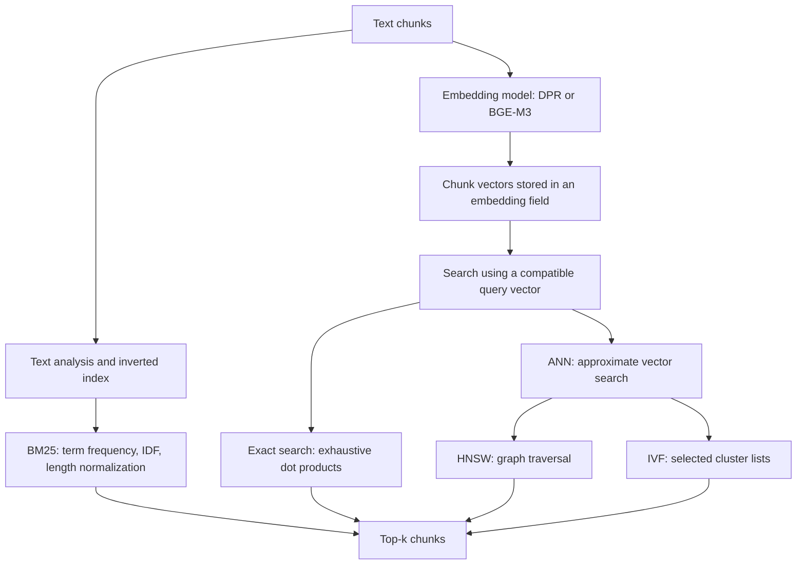
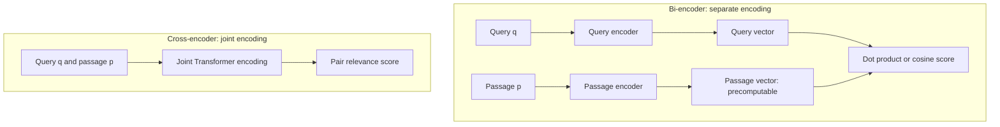
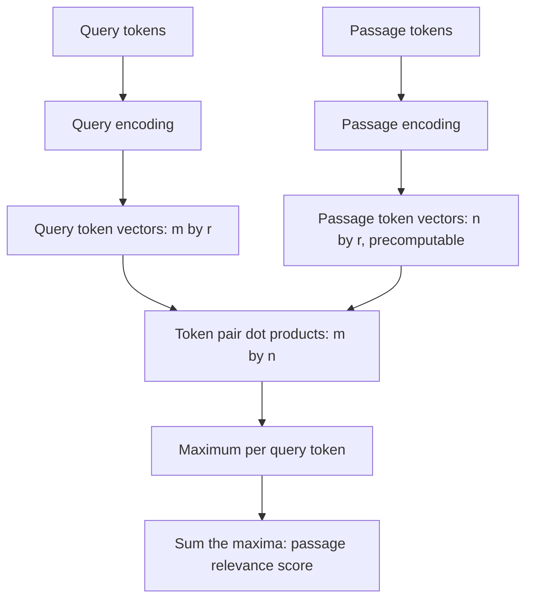

# Week 2 Questions and Answers

Review notes from Lectures 2 and 3. See the [Week 2 references](references.md) and [course materials](../../resources/course-materials.md#l02).

## Lecture 2 reflection and reference summary

The learner summarized the lecture as covering LLM fundamentals, how models are pretrained and post-trained, how inference works, and how LLMs fit into agents.

- **Architecture and training.** A decoder-only Transformer processes a token prefix and scores possible next tokens. Pretraining builds general capabilities. Midtraining can focus the data mix while retaining the next-token objective. Post-training shapes behaviors such as instruction following and tool use through demonstrations, preferences, or rewards. Those stages can update the weights while keeping the architecture fixed. [Training stages](#what-are-the-purpose-inputs-and-outputs-of-pretraining)
- **Inference and serving.** Prefill processes the input prompt and builds its KV cache. Decode reuses that cache while generating subsequent tokens. Distinguish first-token latency from the average time per subsequent token. Inference-time scaling spends more computation per request through additional reasoning or candidate attempts. [Prefill and decode](#what-are-prefill-and-decode-in-llm-inference) · [Inference-time scaling](#what-is-inference-time-scaling)
- **Agent integration.** The model proposes a structured action. The runtime parses and executes it, then adds the tool result to the context for the next call. Constrained decoding can enforce the output schema. Context engineering determines which instructions, history, and retrieved evidence the next model call receives. [Tool-use training and inference](#how-does-agent-specific-training-teach-a-model-to-use-tools) · [Structured I/O](#what-is-constrained-decoding)

### Who produces a file-not-found result and how does the model see it?

The learner correctly attributed the error to the file-reading function and suggested that the model might have skipped an existence check. In the teaching example, the model requests `read_file(path)`. The runtime executes the tool, the file operation raises an error, and the tool or runtime packages it as a tool result. The runtime includes that result in the next model input. The model can then request a directory listing or search to find the correct path. [Tool-use loop](#how-does-agent-specific-training-teach-a-model-to-use-tools) · [File errors and exception handling](references.md#tool-execution-and-file-errors)

The actual cause requires the path, working directory, and execution trace. Reading directly and handling the resulting exception is a valid approach. A file can also disappear between an existence check and a read. [File errors and exception handling](references.md#tool-execution-and-file-errors)

## How do self-attention and recurrence predict the next token?

Both autoregressive models turn the latest hidden representation into vocabulary logits, then select a token with a strategy such as greedy decoding or sampling. They differ in how they build that representation from the prefix.

- **Standard causal self-attention.** A decoder Transformer takes the query for the current position, scores the visible keys, and uses the scores to weight the values. With a KV cache, it computes the current token's key and value and reuses earlier keys and values for each layer.
- **Classic RNN.** The model updates a fixed-width state using the current token and its previous state, as in `h_t = f(W_x x_t + W_h h_(t-1))`. Each step reads that state as its representation of the past.

Let `n` be the prompt length during prefill or the context length at a decoding step, and let `d` be the model width. The table counts forward work per layer with dense projections and full attention. It excludes vocabulary projection and assumes a feed-forward width proportional to `d`.

| Operation | Causal Transformer with KV cache | Classic dense RNN |
|---|---|---|
| Prefill over `n` known tokens | `O(n²d + nd²)` work. Positions in each layer can be processed in parallel. | `O(nd²)` work across `n` dependent state updates. |
| One decoding step | `O(nd + d²)` work. The `nd` term comes from one query attending across the context. | `O(d²)` work for the state update. |
| State carried between decoding steps | `O(nd)` KV cache for standard multi-head attention. | `O(d)` hidden state. |

Holding `d` fixed, full attention is quadratic in prompt length during prefill and linear in context length per cached decode step. The RNN is linear in prompt length and constant in context length per decode step. In ordinary autoregressive decoding, both models feed the selected token into the next step. Parallel processing of known prompt positions does not remove that dependency. [Transformer and KV cache sources](references.md#sources-for-review)

**Lecture 2 connection.** Certain forms of causal linear attention can accumulate past key and value contributions in a fixed-size state. With fixed feature dimensions, that gives constant per-step work and state size with respect to context length. This recurrence computes the linear kernel formulation from the paper. A standard softmax attention layer with a KV cache still attends across stored positions. [Linear attention paper](references.md#sources-for-review)

## Why is standard softmax attention quadratic and linear attention linear?

These costs describe attention over a sequence of `n` tokens, with the head and feature dimensions held fixed.

**Causal softmax attention.** Query `i` scores each key at positions `1` through `i`, applies softmax to those scores, and takes a weighted sum of the corresponding values. There are `1 + 2 + ... + n = n(n + 1)/2` visible query-key pairs. The exponentiated dot products and normalization depend on each query, so direct evaluation takes `O(n²)` work across the sequence. With cached keys and values, one decode step evaluates only the newest query against the prefix and costs `O(n)` in context length.

**Causal linear attention.** The lecture's paper uses a similarity of the form $\phi(q_i)^T\phi(k_j)$ for a finite-dimensional feature map $\phi$. Because the query features are the same for every term in the sum for position `i`, they can be factored out. Keep these running prefix sums:

$$
S_i = S_{i-1} + \phi(k_i)v_i^T, \qquad z_i = z_{i-1} + \phi(k_i).
$$

The output is $y_i = \phi(q_i)^T S_i / (\phi(q_i)^T z_i)$. The denominator still normalizes the weights. The state holds the accumulated key and value contributions, with no separate entry for each prior token. For feature dimension `r` and value dimension `d_v`, the accumulator update and read take `O(r × d_v)` per position. That is `O(n × r × d_v)` across the sequence, linear in `n` at fixed dimensions. This computation is exact for the paper's chosen kernel. Standard softmax uses an exponential dot-product kernel whose exact feature map is not finite-dimensional. [Attention derivations](references.md#sources-for-review)

## Does the attention design change decoding and inference context length?

Both systems use the same autoregressive loop and can use the same token selection strategy. The difference is in the attention layer, which processes the prefix during prefill and carries state into decoding. Full softmax attention keeps per-token keys and values in a growing KV cache. The lecture's causal linear attention folds token contributions into fixed-size accumulators. Per decoding step, the attention work is `O(n)` for full softmax with cached keys and values and `O(1)` for the linear formulation, relative to context length `n` at fixed dimensions. [Cache and linear attention sources](references.md#sources-for-review)

This changes the compute and memory budget for processing longer contexts. A model's supported token limit also depends on the model design and serving configuration. Effective context length is a separate quality question: how much of a long input the model can reliably retrieve and use for a given task. Fixed-size accumulation reduces the state that must be carried, and long-range retrieval quality should be evaluated on representative tasks. [RULER benchmark](references.md#long-context-evaluation)

## What determines an LLM's context window?

- **Model support.** The attention pattern determines which positions can interact and the cost of doing so. Positional encoding determines how the model represents token positions. The lengths used during training and the evaluations used to validate long inputs inform the supported limit. For example, Meta used RoPE and extended the Llama 3 405B context window from 8K to 128K during continued pre-training. [Model and serving sources](references.md#context-windows-and-serving)
- **Deployment limit.** The serving runtime can set a lower cap to fit its memory and performance budget. For example, vLLM's `--max-model-len` covers prompt and generated tokens together. Under a 32,000-token shared cap, reserving 4,000 tokens for output leaves 28,000 for the complete prompt. [Model and serving sources](references.md#context-windows-and-serving)
- **Effective context.** How well the model uses the available tokens depends on the task. A model may accept a long document and struggle to connect information across it. Evaluate retrieval and reasoning at the lengths the application needs. [RULER](references.md#long-context-evaluation)

## What are the purpose, inputs, and outputs of pretraining?

For a causal LLM, pretraining from scratch builds broad language and completion capabilities using large, diverse text and code corpora. The training run takes a model architecture, newly initialized weights, a tokenizer, and tokenized training data. Its main artifact is a base model checkpoint containing the learned weights. Given a prefix, that checkpoint can assign probabilities to possible continuations.

Within a training batch, the input is a sequence of token IDs and the target at each position is the next token ID from that same sequence. In a simplified four-token example, the forward inputs are `[The, server, returned]` and the aligned targets are `[server, returned, 404]`. The forward pass produces vocabulary logits at each position. A causal mask prevents a position from seeing its future target. The trainer computes next-token cross-entropy and updates the weights using gradients. The correct prefix comes from the training data, so known positions can be processed together rather than sampled one by one. [Training sources](references.md#pretraining-and-midtraining)

## What are the purpose, inputs, and outputs of midtraining?

Midtraining commonly means a targeted continuation of pretraining before post-training. It starts from a pretrained checkpoint and uses a curated data mix to strengthen capabilities such as math, coding, or domain knowledge. Some recipes also use late-stage training to extend context length. Teams vary in where they draw the stage boundaries and what they call each phase.

Many midtraining recipes retain the next-token objective. In that case, batch inputs, targets, and logits work as in pretraining. The main changes are the starting weights and the training data distribution. The output is an updated base checkpoint for downstream use or post-training. Ai2's Olmo 3 report describes starting with Dolma 3 Mix and continuing on a 100B-token Dolmino mix selected for skills such as math, code, and knowledge QA. The authors retained some general web and PDF data to balance the targeted gains with broader capabilities. [Olmo 3 and training sources](references.md#pretraining-and-midtraining)

## Does midtraining change the architecture or the weights?

Olmo 3 uses the same decoder-only Transformer architecture for pretraining and midtraining. The architecture specifies the operations and connections. The weights are the learned numbers used by those operations, such as the entries in an attention or feed-forward weight matrix. Midtraining loads the earlier checkpoint, computes gradients on a new data mix, and updates the trainable parameters. The updated checkpoint can assign different next-token probabilities to the same prefix. [Olmo 3 architecture and training sources](references.md#pretraining-and-midtraining)

## What are the purpose, inputs, and outputs of post-training?

Post-training starts with a base checkpoint, typically after any midtraining, and trains it toward behaviors such as following instructions, using a requested format, or generating responses that meet a quality criterion. Intermediate checkpoints can feed later stages. The output of the pipeline is a checkpoint tuned for the intended use.

Inputs depend on the method. Supervised fine-tuning uses prompts with demonstration responses. Direct preference optimization uses prompts with a preferred and a less preferred response. Reinforcement learning with verifiable rewards uses prompts, model-generated responses, and rewards from checks such as unit tests. The Olmo 3 Think recipe uses these three techniques in sequence. [Post-training sources](references.md#post-training-and-instruction-tuning)

## What are the purpose, inputs, and outputs of instruction fine-tuning?

In the common supervised form, instruction fine-tuning teaches a model to respond to a request as an assistant. It starts from a pretrained or intermediate checkpoint and uses examples such as a user asking for a one-sentence explanation of HTTP 404 followed by a reference assistant answer that respects the requested format.

The chat template serializes both sides into tokens. The instruction and earlier answer tokens provide context for predicting each successive answer token. A common SFT configuration masks the loss on system and user tokens and computes next-token cross-entropy on assistant tokens. The forward pass outputs vocabulary logits. The completed training run outputs an instruction-tuned checkpoint, which can be deployed or used for later post-training. [SFT and post-training sources](references.md#post-training-and-instruction-tuning)

## What are the purpose, inputs, and outputs of human feedback?

In preference collection, human feedback supplies a judgment about which response better serves the request. A reviewer receives a prompt and two or more candidate responses, usually generated by a model, and evaluates them against quality criteria. The output is labeled comparison data, such as `(prompt, preferred response, less preferred response)`. For example, when a prompt asks for a one-sentence explanation of HTTP 404, the reviewer can prefer a correct one-sentence answer over an equally correct but longer answer.

In classic RLHF, comparison data trains a reward model that takes a prompt and candidate response and outputs a scalar score. The assistant then generates new responses, the reward model scores them, and reinforcement learning updates the assistant's weights. The final artifact is an updated assistant checkpoint. DPO can instead consume the labeled preference pairs directly to update the assistant, without fitting a separate reward model. InstructGPT also collects human-written demonstrations for its earlier SFT stage. [InstructGPT and DPO sources](references.md#human-feedback)

## How does agent-specific training teach a model to use tools?

Agent-specific post-training adapts a starting checkpoint to make decisions over several steps, such as choosing a tool, providing arguments, interpreting the returned data, and deciding when to answer. In supervised fine-tuning, the input to the training run is the starting checkpoint and recorded trajectories. A trajectory contains a task, tool definitions, assistant actions, tool results, and a final response. The trainer computes next-token loss on the target assistant messages. Tool results provide context for later predictions. The run outputs an updated checkpoint. [Olmo 3 function-calling training](references.md#agent-specific-training)

For a simplified scholarly search example, the user asks who the first author of ReAct is. The assistant calls `search_papers(query="ReAct reasoning and acting language models")`. The tool returns `arXiv:2210.03629`. The assistant calls `get_paper(paper_id="arXiv:2210.03629")`. The tool returns the author metadata, and the assistant answers `Shunyu Yao`. The two calls and the answer are assistant targets. The ID and metadata are observations produced by the tools. This is a teaching example inspired by Olmo 3's scholarly search setting. [Function-calling report and ReAct paper](references.md#agent-specific-training)

In reinforcement learning, the model generates fresh trajectories in a tool environment. A scorer evaluates the outcome, and the trainer uses the reward to update the model. Search-R1 uses final answer correctness to reward behavior across multiple retrieval steps. At deployment, the runtime executes each tool call and returns its result to the model. The model then generates its next action or final answer. [Search-R1](references.md#agent-specific-training)

## What is SWE-smith?

SWE-smith is a framework for building training tasks for software engineering agents from real Python repositories and their test suites. It sets up runnable repository environments, introduces synthetic bugs that make previously passing tests fail, and creates issue descriptions for accepted tasks. Each task pairs a buggy repository state and a task description with tests that can evaluate a candidate fix. [SWE-smith paper and project](references.md#swe-smith-and-swe-bench)

In a simplified example, a pagination change skips the first record on page one. SWE-smith can turn that behavior into a task with a failing test and an issue description. A teacher agent can attempt the task, generating a trajectory of file reads, edits, and test runs. A successful trajectory can then become an SFT example. In the paper, the authors generated about 50,000 tasks and used 5,016 successful trajectories to fine-tune Qwen2.5-Coder-32B-Instruct. SWE-bench supplies held-out evaluation tasks in that experiment. [SWE-smith and SWE-bench papers](references.md#swe-smith-and-swe-bench)

## Is the fine-tuned SWE-smith model still decoder-only?

Yes. Qwen2.5-Coder-32B-Instruct and the resulting SWE-agent-LM-32B checkpoint both use the decoder-only `Qwen2ForCausalLM` architecture. Fine-tuning updates the weights, changing which continuations the model assigns high probability. At inference, the model takes a tokenized prefix and produces logits over the vocabulary. The decoding procedure selects the next token and repeats to form an assistant turn. A single user sentence can be the whole user message, and the model's actual input also includes the chat formatting and any context the application supplies. [Qwen and SWE-agent-LM configurations](references.md#swe-smith-and-swe-bench)

In the pagination example, the user's request can be one sentence. The agent runtime adds tool definitions and any relevant history to the model input. The model can generate a request to read the pagination code. The runtime runs the tool, adds the file contents to the context, and calls the same model again. One user request can therefore span several model turns before the final answer. [Tool-use training and inference](#how-does-agent-specific-training-teach-a-model-to-use-tools)

## What are prefill and decode in LLM inference?

In a decoder-only Transformer with a KV cache, prefill processes the known prompt tokens. Each layer can compute the prompt positions in parallel under a causal mask. The model stores each prompt token's keys and values for each layer. The logits from the final prompt position are used to select the first generated token. [Inference and serving sources](references.md#inference-and-serving)

In ordinary autoregressive decode, each step feeds the most recently selected token into the same model. Its query attends to the cached keys and values plus its own key and value. The model adds that token's keys and values to the cache and returns logits for the next token. With a hypothetical prompt `[P1, P2, P3]`, prefill caches `P1` through `P3` and selects `Y1`. The first decode step processes `Y1`, adds its keys and values to the cache, and selects `Y2`. Each subsequent step depends on the token selected in the previous step. [Inference and serving sources](references.md#inference-and-serving)

With full causal attention and fixed model dimensions, an uncached `n`-token prompt takes `O(n²)` attention work during prefill. A single cached decode step takes `O(n)` attention work at context length `n` because one query still attends to the full available context. Prefill contributes to time to first token (TTFT), which can also include queueing and other overhead. Decode drives time per output token (TPOT) after the first token. [Attention comparison](#how-do-self-attention-and-recurrence-predict-the-next-token) · [Inference and serving sources](references.md#inference-and-serving)

### Why can decode reuse the old keys and values?

The causal mask lets each position attend only to itself and earlier positions. Appending `Y1` leaves the prefix and position of `P2` unchanged, so `P2` has the same hidden representation and therefore the same key and value at each layer. The model reuses the cached keys and values for `P1`, `P2`, and `P3` and computes fresh attention scores using `Y1`'s query.

When the model processes `Y1`, each layer computes `q_Y1`, `k_Y1`, and `v_Y1`. The key and value caches each grow by one token position. In a single-head view, the key matrix goes from `[k_P1; k_P2; k_P3]` to `[k_P1; k_P2; k_P3; k_Y1]`, and the value matrix grows the same way. The model uses the new query for this step and caches the new key and value for later steps. Its resulting logits are used to select `Y2`. [KV cache mechanics](references.md#inference-and-serving)

### Does prefill happen once per generation?

For one ordinary generation, the serving engine prefills the input prompt, selects `Y1` from the resulting logits, then runs cached decode steps for subsequent tokens until a stop condition or output limit. Each decode step extends the KV cache with the token it processes. A new chat message or tool result supplies more input for the next generation. If the engine can reuse the KV cache for a matching prefix, it can process just the uncached suffix. [Inference and prefix caching](references.md#inference-and-serving)

### Which latency metrics do prefill and decode affect?

Prefill primarily affects time to first token (TTFT), measured from request start to the first output token. Depending on the measurement boundary, TTFT also includes overhead such as queueing, tokenization, and network transport. Decode primarily affects time per output token (TPOT), measured as `(last token time - first token time) / (output tokens - 1)` for a response with at least two output tokens. If an 11-token response delivers its first token at 200 ms and its last at 700 ms, the TTFT is 200 ms and the TPOT is 50 ms per token. The latency through the last token includes both phases. Speculative decoding targets the work after the first token and aims to reduce TPOT. [DistServe](references.md#inference-and-serving) · [Speculative decoding sources](references.md#speculative-decoding)

## What is speculative decoding?

A fast draft model proposes several continuation tokens autoregressively. The target model scores the known draft positions in parallel in one verification pass, using the cached prefix and a causal mask. Since the draft tokens are already available, each position can be evaluated under its proposed prefix. [Lecture slides and decoding papers](references.md#speculative-decoding)

In a greedy example, the draft proposes `[A, B, C, E]`. The target agrees with `A` and `B`, then prefers `D` after `[A, B]`. The engine emits `[A, B, D]`, discards the remaining draft, and continues from the corrected prefix. The scores after the first mismatch were conditioned on a draft token that will not be emitted. With greedy decoding, the accepted and corrected tokens match what the target alone would select. With sampling, the original algorithms use an acceptance and correction rule to preserve the target model's output distribution. [Speculative decoding papers](references.md#speculative-decoding)

The speedup comes from producing multiple output tokens in fewer sequential target model passes. It depends on the cost of drafting and verifying and how often the target accepts a long draft prefix. [Performance analysis](references.md#speculative-decoding)

## What is inference-time scaling?

Inference-time scaling, also called test-time scaling, spends more computation on an individual request to improve its chance of success. The deployed model weights stay fixed. Lecture 2 shows two ways to spend the budget. A single run can use more reasoning tokens to develop and check an answer. Alternatively, the system can sample several candidates and select one using a verifier, such as tests for a code change. Self-consistency selects the most common final answer across sampled reasoning paths when a reliable verifier is unavailable. [Lecture and paper references](references.md#inference-time-scaling)

In the lecture's jacket example, a check of the two percentage bases catches the tempting answer of $80. The 25 percent increase takes the price to $100, and the 25 percent discount takes it to $75. More reasoning or candidate attempts consume extra tokens or calls. Their benefit depends on how useful those attempts are and how well the system can select a correct answer. [Lecture and paper references](references.md#inference-time-scaling)

### What is Inkling, and what does lambda control?

Inkling is an open-weight multimodal model from Thinking Machines Lab. Lecture 2 uses it to illustrate controllable reasoning effort. During reinforcement learning, the team conditioned training rollouts on different effort levels using a system message and adjusted the per-token cost. The lecture denotes that cost coefficient by lambda. With a larger lambda at low effort, extra generation reduces the reward more. With a smaller lambda at high effort, additional generation carries a lower penalty. [Lecture and Inkling sources](references.md#inference-time-scaling)

At inference, the caller supplies the desired effort and uses the same model weights. The learned behavior can spend more or fewer tokens in response to that setting. The effort setting controls the model's tendency to spend computation, while a separate output token limit bounds generation. [Thinking effort documentation](references.md#inference-time-scaling)

### How does scaling with repeated sampling work?

Here, scaling means increasing the inference compute spent on one task by sampling more candidates. For example, hold the model and task fixed, increase `k` from 1 to 4 to 16, and measure how candidate coverage, final answer accuracy, and cost change. [Lecture and repeated sampling paper](references.md#inference-time-scaling)

Sample `k` candidate solutions to the same task from the same model and use a verifier or selection rule to choose among them. For example, generate four separate fixes for the pagination bug. If the third candidate is the only one that passes the bug-specific and regression tests, the runner returns that candidate. The extra attempts use more inference compute even when they run in parallel. [Lecture and repeated sampling paper](references.md#inference-time-scaling)

Coverage measures whether the candidate set contains at least one correct solution. For coding tasks with a defined pass criterion, this is pass@k. If each attempt succeeds independently with probability `p` on the same task, the probability of at least one success is `1 - (1 - p)^k`. With `p = 0.20` and `k = 4`, this is approximately 59 percent. The accuracy of the returned answer also depends on whether the selector can find the successful candidate. For example, majority voting can miss a correct solution that appears only once. [Coverage and verification findings](references.md#inference-time-scaling)

## What is constrained decoding?

Constrained decoding enforces an output format as the model generates. At each generation step, the model produces next-token logits. The serving engine checks which tokens can extend the generated prefix under the supplied grammar or supported schema, masks the invalid tokens, and selects from the remaining candidates. The engine updates the grammar state and repeats. [Lecture and implementation sources](references.md#structured-io-and-constrained-decoding)

In the lecture's intent extraction example, the allowed labels are `meeting`, `intro`, and `follow-up`. A JSON schema with this enum can restrict the generated value of `intent` to those strings. Several model tokens may be needed to spell a valid label. The schema enforces the allowed labels, and the model still has to infer which one describes the message. [Lecture and implementation sources](references.md#structured-io-and-constrained-decoding)

### Is constrained decoding done through the prompt?

The prompt tells the model what task to perform and can explain the meanings of the intent labels. The application supplies the output contract separately to a serving engine such as vLLM, which accepts a JSON Schema in `structured_outputs.json`. The engine can enforce the schema even when the prompt omits the schema text. The engine can compile it into a grammar and track the grammar state over the output prefix. Before each sampling step, it sets the logits of tokens that cannot continue that grammar to negative infinity. The sampler chooses among legal continuations according to the remaining model scores. After choosing a token, the engine advances the grammar state and builds the next mask. A system that only puts a format instruction in the prompt relies on the model following that instruction. [Serving API and implementation](references.md#structured-io-and-constrained-decoding)

## What is a System One model?

In Lecture 2, the term refers to fast decision models that directly score the candidates available for a request. Think of a classifier whose candidate labels and their descriptions can be passed in at inference time. For example, a support router can supply `Billing`, `Technical Support`, and `Human Handoff` as options for a request about a duplicate charge. It can also supply different options for requests from another workflow. The scores or selected label go directly to the router. [Lecture and CLM sources](references.md#system-one-models)

The lecture cites Contrastive Language Models (CLMs) as one implementation. A CLM separately embeds the current state and each candidate action. It trains with a contrastive objective so matching state-action pairs have higher similarity. At inference, it scores each candidate by the dot product of the embeddings and selects the highest-scoring option. An implementation can reuse embeddings for recurring candidates. [CLM implementation](references.md#system-one-models)

## What does avoid bloat mean in context engineering?

Lecture 2 applies this principle to both tool selection and information retrieval. Expose a focused set of tools with clear responsibilities. The lecture uses Pi's four core tools, `read`, `write`, `edit`, and `bash`, as an example. Keep files and memories available to the agent and retrieve the pieces relevant to the current task. [Lecture and context engineering sources](references.md#avoiding-context-bloat)

For a failing pagination test, start with the failure output, the test, and the relevant implementation. If the task also depends on the API's pagination contract, retrieve that contract and add it to the context. A focused context saves input tokens and reduces distracting information while retaining the evidence needed to make the next decision. [Lecture and context engineering sources](references.md#avoiding-context-bloat)

## What does add sequentially mean for the KV cache?

The lecture recommends appending new context to the end of the existing prompt so that a serving engine can reuse a matching cached prefix. In a token-level illustration, appending `X` to `[A, B, C]` preserves the prefix `[A, B, C]`. Inserting `X` to produce `[A, X, B, C]` preserves only `[A]`. The later tokens can have new positions and a new causal context, so the engine needs to run prefill on the changed suffix. Even a same-length edit can change what later tokens attend to. [Lecture and prefix caching sources](references.md#prefix-reuse-in-agent-context)

Keep stable system instructions and tool definitions near the front, preserve the order and formatting of existing messages, and append new messages and relevant tool results in order. The cache operates on tokenized prefixes. For example, vLLM caches complete blocks and can reuse a matching block while it is resident. If the task needs updated instructions or compacted history, make the change and prefill the affected suffix. [Prefix caching implementation](references.md#prefix-reuse-in-agent-context)

Prefill builds the initial KV cache for the prompt. Decode extends it with the generated tokens that are fed back into the model. A later request can reuse either portion when it remains part of the matching cached prefix. Preserve the context the next request still needs in a stable prefix to avoid recomputing its keys and values. [Cache mechanics](references.md#inference-and-serving) · [Prefix caching implementation](references.md#prefix-reuse-in-agent-context)

## What is a Recursive Language Model and what problems does it address?

A Recursive Language Model (RLM) is an inference strategy that lets a language model inspect and process a long input from an external environment. In the paper, the full input lives in a Python REPL variable. The root model writes code to inspect, filter, or split it, invokes language model subcalls on selected pieces, and combines the results. The recursive part is that a language model can invoke another language model call on a smaller subproblem. The context window still applies to each individual call. [Lecture and RLM sources](references.md#recursive-language-models)

For example, to count duplicate-charge incidents across a large support-ticket archive, the root model could split the archive into batches, ask subcalls to classify tickets and return matching IDs and evidence, then use code to deduplicate and count the results. This can help when the source data exceeds a single context window or when an answer requires aggregating evidence across many parts of the input. Classification errors still affect the final count, and repeated calls add inference work. [RLM mechanism and experiments](references.md#recursive-language-models)

## Lecture 3 reflection and reference summary

On November 23, the learner reported finishing the video and summarized learning what RAG is, the technical details of retrieval, and the generation stage. This is their high-level reflection, translated into English. Earlier Q&A records their explanations of the embedding pipeline and ColBERT's encoder-plus-MaxSim design.

The mentor supplied this reference summary after receiving the learner's reflection:

- **Pipeline.** Offline indexing prepares searchable evidence. At query time, retrieval returns candidate passages and generation uses selected evidence to compose an answer.
- **Representations and search.** Contextual retrieval, late chunking, RAPTOR, and GraphRAG change how evidence is represented or organized. BM25 uses lexical statistics; DPR and BGE supply learned dense representations; HNSW and IVF organize vector search, and PQ compresses vectors. [Retrieval mechanisms](references.md#contextual-retrieval-and-elasticsearch)
- **Ranking.** Single-vector bi-encoders support precomputed passage vectors. Cross-encoders jointly score query-passage text pairs. ColBERT retains token-level vectors and uses MaxSim, trading additional storage and matching work for finer-grained evidence. [Encoder comparison](references.md#bi-encoders-and-cross-encoder-reranking) · [ColBERT](references.md#late-interaction-and-colbert)
- **Evaluation.** Hit, Recall, MRR, and nDCG are higher-is-better; Failed is lower-is-better. Compare the same queries, relevance judgments, corpus, and cutoff. Evaluate generated-answer correctness and evidence support separately from retrieval quality. [Retriever evaluation](references.md#retriever-evaluation)
- **Adaptive control.** Self-RAG learns retrieval and critique tokens; CRAG evaluates evidence and selects corrective routes; Search-R1 uses reinforcement learning to improve search-and-answer behavior. [Self-RAG](references.md#self-rag) · [CRAG and Search-R1](references.md#crag-and-search-r1)

The intended application is to trace a question through retrieval, ranking, context assembly, and answer generation, then diagnose whether a failure comes from missing evidence or unsupported use of available evidence. The video and reflection are recorded; a live retrieval comparison and independent assessment of the agentic mechanisms remain for later course work. No additional exercise or reading is assigned before L04.

## What do retrieval and generation do in RAG, and how are production systems evolving?

The online RAG path has two core responsibilities. Retrieval takes a query and a searchable corpus and returns candidate evidence with source metadata. Generation takes the question, selected evidence, and instructions and produces an answer. Lecture 3 models these as a retriever over passages and a generator conditioned on the query and retrieved passage. [Course pipeline](references.md#rag-pipeline)

Before serving requests, an indexing pipeline parses documents, splits them into useful chunks, preserves source and version metadata, and builds the required search indexes. BM25 uses an inverted index. Dense retrieval stores document embeddings and encodes queries into a compatible vector space for similarity search. Each index needs to reflect changes to its source content. [Indexing and contextual retrieval](references.md#rag-pipeline)

For a hypothetical question about retrying an order API after a timeout, retrieval can preserve the API version, run keyword search for exact identifiers and dense search for semantically related passages, merge the ranked lists, and rerank the candidates. For example, retrieve 50 candidates and select five evidence passages. These counts are illustrative. The output should contain passage text, document IDs, and source locations. The generator uses that evidence to explain the documented retry behavior, cite its sources, or identify an unresolved question. [Hybrid retrieval](references.md#rag-engineering-practice) · [Generation and evaluation](references.md#rag-evaluation)

As of November 19, 2026, the cited public implementations show several engineering directions. Elastic documents hybrid search with rank fusion. Anthropic adds document context to chunks before indexing and measures the benefit of reranking. Azure documents agentic retrieval that plans multiple queries, retrieves evidence, and combines results. This is a synthesis of these implementations. The appropriate design depends on the corpus, query workload, and latency budget. [Implementation references](references.md#rag-engineering-practice)

Evaluate the two responsibilities independently. Retrieval evaluation checks whether the needed evidence appears in the returned candidates. Generation evaluation checks whether the answer addresses the question and whether its claims are supported by the supplied evidence. Track end-to-end correctness, latency, and cost as well. [RAG evaluation sources](references.md#rag-evaluation)

## How does contextual retrieval work with Elasticsearch chunks and indexes?

Contextual retrieval adds a short passage-specific description derived from the source document before indexing a chunk. The resulting `search_text = context + chunk_text` feeds both lexical indexing and the embedding model. Anthropic generates this description from the document and chunk during preprocessing. [Original method and implementation](references.md#contextual-retrieval-and-elasticsearch)

The following API documentation is a constructed teaching example. Its retention period and behavior are hypothetical.

| Chunk | Source | Original text | Added context |
|---|---|---|---|
| C1 | Orders API v2, Idempotency | Reuse the same key when retrying. It is retained for 24 hours. | Orders API v2. Idempotency keys for order creation. |
| C2 | Orders API v2, Timeout recovery | A timeout does not imply failure. Query the operation status before retrying. | Orders API v2. Recovery after a client timeout during order creation. |
| C3 | Subscriptions API v1, Cancellation | Cancellation takes effect at the end of the billing period. | Subscriptions API v1. Subscription cancellation timing. |

One Elasticsearch document per chunk is a simple schema. C1 can be submitted under `_id = C1` with this payload. The four-dimensional vector is manually chosen for illustration.

```json
{
  "doc_id": "orders-v2-guide",
  "product": "orders",
  "version": "v2",
  "chunk_no": 1,
  "source": "orders-v2-guide#idempotency",
  "chunk_text": "Reuse the same key when retrying. It is retained for 24 hours.",
  "context": "Orders API v2. Idempotency keys for order creation.",
  "search_text": "Orders API v2. Idempotency keys for order creation. Reuse the same key when retrying. It is retained for 24 hours.",
  "embedding": [0.9, 0.1, 0.0, 0.0]
}
```

Map `search_text` as `text`, `product` and `version` as `keyword`, and `embedding` as `dense_vector`. The text analyzer produces terms for the inverted index. A dense vector field with indexing enabled builds its configured approximate nearest-neighbor index. The stored text and source metadata support evidence construction after retrieval. Actual embedding dimensions must match the embedding model. [Elasticsearch field and analyzer documentation](references.md#contextual-retrieval-and-elasticsearch)

### Which fields does Elasticsearch search in a contextual chunk document?

Elasticsearch indexes fields according to their mapping. In the worked schema, `search_text` is an indexed text field and supports analyzed lexical matching with BM25. The application constructs it by concatenating context and original text. The separate `context` and `chunk_text` fields have indexing disabled and remain available in the returned source. The indexed `embedding` field supports vector search. Multiple chunk documents contribute to each searchable field's index. A query identifies the field to search, and the index locates matching chunk IDs. [Field and retrieval documentation](references.md#contextual-retrieval-and-elasticsearch)

The learner correctly confirmed the two retrieval branches. For lexical retrieval, analyze `search_text`, build the inverted index, and rank matches to the analyzed query using BM25. For dense retrieval in this contextual preprocessing example, embed `search_text` at indexing time, embed the question at query time, and use kNN to find nearby stored chunk vectors. Both branches return chunk document IDs. [Retrieval mechanisms](references.md#contextual-retrieval-and-elasticsearch)

For vector retrieval, the application first encodes the question using a compatible query embedding model. The following current retriever API example uses a manual four-dimensional vector to match the earlier toy schema. The RRF filter applies product and version constraints to both branches. `_source` selects the evidence fields returned to the application. The request is a documentation-based illustration and has not been run against a cluster.

```json
{
  "size": 2,
  "_source": ["chunk_text", "context", "product", "version", "source"],
  "retriever": {
    "rrf": {
      "retrievers": [
        {
          "standard": {
            "query": {
              "match": {"search_text": "orders v2 idempotency key retained"}
            }
          }
        },
        {
          "knn": {
            "field": "embedding",
            "query_vector": [1, 0, 0, 0],
            "k": 10,
            "num_candidates": 100
          }
        }
      ],
      "filter": {
        "bool": {
          "filter": [
            {"term": {"product": "orders"}},
            {"term": {"version": "v2"}}
          ]
        }
      },
      "rank_window_size": 10,
      "rank_constant": 60
    }
  }
}
```

Submit the body to `POST rag_chunks/_search`. The standard branch ranks lexical matches, the kNN branch ranks nearby stored vectors, and RRF merges ranks by document ID. The application receives selected chunks and builds the generator's context from their text and source references. [Current RRF API](references.md#contextual-retrieval-and-elasticsearch)

### Where do ANN, HNSW, and PQ fit in the example?

kNN is the retrieval objective of finding the k nearest vectors. Exact retrieval and approximate nearest-neighbor search (ANN) are two ways to pursue that objective. ANN trades exact top-k recall for faster or more compact search. HNSW is one ANN indexing method that organizes vectors into a hierarchy of navigable proximity graphs. PQ, product quantization, divides vectors into subvectors and represents each with a codebook entry, enabling compressed storage and approximate distance calculations. PQ can participate in an ANN implementation alongside a search index. These concepts apply to the dense vector branch in this example. The lexical branch uses inverted postings and BM25 scoring. [Vector search and compression sources](references.md#approximate-vector-search-and-quantization)

The earlier displayed teaching mapping explicitly selected `index_options.type = hnsw` for its four-dimensional dense vector field, and its kNN query was designed to use that index. PQ was not configured. All Elasticsearch requests remain examples that have not been executed against a cluster. If index options are omitted in a deployment, the actual vector format depends on the mapping and Elasticsearch version. Elastic also documents scalar and binary quantized index formats. [Elasticsearch vector index settings](references.md#approximate-vector-search-and-quantization)

Two sources of approximation help explain the distinction. HNSW can miss a true neighbor because its graph exploration visits a subset of candidates. PQ represents original vectors with quantized codes, so its approximate distances can change the ranking even when every stored code is scanned. Faiss exposes both `IndexHNSWFlat` and `IndexPQ`, illustrating these mechanisms. [Faiss index implementations](references.md#approximate-vector-search-and-quantization)

### How does product quantization train, encode, and search vectors?

PQ divides each vector into M subvectors. During training, it learns a separate codebook for each subspace using k-means over training embeddings. At encoding time, each subvector is replaced by the ID of its nearest centroid. With 256 centroids per codebook, each ID takes 8 bits. At query time, a common method keeps the query uncompressed, calculates its subvector distances to the centroids, and sums the entries selected by each stored code. [Product quantizer algorithm](references.md#approximate-vector-search-and-quantization)

For a constructed vector `x = [1.1,1.9,8.2,7.8]`, suppose its two selected codebook entries are code 7 for `[1,2]` and code 21 for `[8,8]`. Its code is `[7,21]`, representing the approximation `[1,2,8,8]`. For query `q = [1,2,8,7]`, the exact squared L2 distance is 0.7 and the PQ distance is `0 + 1 = 1.0`. Local Python arithmetic verified these values. The original four float32 values use 16 bytes and the two 8-bit codes use 2 bytes, with codebooks and index metadata stored separately. The codebooks and choices here are hypothetical, with no training run performed.

### How does IVF relate to ANN, HNSW, and PQ?

IVF, inverted file indexing, is commonly used for ANN retrieval. A coarse quantizer assigns stored vectors to clusters, and each cluster has a list of vector IDs. At query time, the system selects `nprobe` lists from the `nlist` clusters and searches their contents. Restricting the lists can miss a true neighbor located elsewhere. With one million vectors evenly distributed over 1,000 lists, probing 10 lists examines about 10,000 stored vectors, plus the work to choose the lists. This is a hypothetical balanced example. [IVF mechanism](references.md#approximate-vector-search-and-quantization)

IVF organizes candidate search through clusters and posting lists, while HNSW uses proximity graph traversal. PQ determines a compressed representation and approximate distance calculation. Faiss supports `IndexIVFFlat`, `IndexIVFPQ`, `IndexHNSWFlat`, and `IndexHNSWPQ`, showing how either search structure can use original vectors or PQ encoding. The vector IVF lists are keyed by cluster assignments. The lexical postings used by BM25 are keyed by text terms. [Faiss index combinations](references.md#approximate-vector-search-and-quantization)

Both lexical inverted indexes and vector IVF share the organization of an index key mapped to a list of record IDs. In text retrieval, invert `C1 -> [order, retry]` and `C2 -> [order, timeout]` into `order -> [C1,C2]`, `retry -> [C1]`, and `timeout -> [C2]`. In standard IVF, assigning `v_C1` and `v_C2` to centroid 7 creates `7 -> [v_C1,v_C2]`. Text queries choose posting lists through analyzed terms and use BM25 for scoring. IVF queries choose lists through similarity to centroids and then score the vectors within those lists. Their common organizing principle supports different query and scoring operations. [IVF posting lists](references.md#approximate-vector-search-and-quantization) · [Text indexing](references.md#contextual-retrieval-and-elasticsearch)

| Method | Stored organization | Query operation | Main role |
|---|---|---|---|
| Text inverted index | Term to chunk IDs, with term statistics | Select term postings and rank matches using BM25 | Lexical candidate retrieval and ranking |
| Vector IVF | Centroid to assigned vector IDs | Choose nearby centroids, then search their lists | Reduce the vector candidate set |
| PQ | Subvector codebooks and per-vector codes | Add query-to-centroid distance table entries selected by each code | Compress vectors and approximate distances |
| HNSW | Vectors linked in a hierarchical proximity graph | Navigate the graph and explore candidate neighbors | Reduce the vector candidate set |

IVF and HNSW organize candidate discovery. PQ can supply compressed representations and distance calculations within such systems. The teaching Elasticsearch configuration uses text postings with BM25 and a HNSW dense vector field. [Vector method references](references.md#approximate-vector-search-and-quantization)

The learner correctly grouped these concepts into lexical and dense vector retrieval. Both retrieve candidate evidence for RAG. Lexical retrieval uses analyzed text terms and scoring such as BM25. Dense retrieval searches embeddings using indexes such as IVF or HNSW, potentially with compression such as PQ. Combining the two retrieval branches and fusing their results is hybrid search. [RAG retrieval references](references.md#rag-engineering-practice)

### What do an inverted index, TF-IDF, and BM25 contribute?

For a hand calculation, shorten the three indexed texts to the following toy corpus. The model tokenizer used for embeddings and the search analyzer can produce different tokenizations.

| Document | Search terms | Length |
|---|---|---|
| C1 | orders v2 retry key key | 5 |
| C2 | orders v2 timeout retry | 4 |
| C3 | subscriptions v1 cancellation | 3 |

The inverted index includes `retry -> {C1: 1, C2: 1}`, `key -> {C1: 2}`, and `timeout -> {C2: 1}`. These are logical postings represented with chunk IDs. Lucene uses internal document IDs and can also store token positions. Term frequency `f(t,d)` counts occurrences within one indexed document. Document frequency `df(t)` counts indexed documents containing the term. Here `N = 3` counts chunks, and `avgdl = 4`.

A simple TF-IDF illustration uses `idf(t) = ln(N / df(t))` and sums `f(t,d) * idf(t)` over distinct query terms. For query `retry key`, its scores are C1 = 2.602690, C2 = 0.405465, and C3 = 0. TF-IDF has several weighting and normalization variants. [Term weighting reference](references.md#contextual-retrieval-and-elasticsearch)

With unit query boosts, Lucene's BM25 term contribution can be written as `idf(t) * f(t,d) / (f(t,d) + K(d))`, where `idf(t) = ln(1 + (N - df(t) + 0.5) / (df(t) + 0.5))` and `K(d) = k1 * (1 - b + b * length(d) / avgdl)`. Using `k1 = 1.2` and `b = 0.75`, the toy query scores are C1 = 0.766563, C2 = 0.213638, and C3 = 0. Repeated terms have diminishing contribution, while field length affects normalization. The common textbook form also includes a constant factor of `k1 + 1`. Actual Elasticsearch explanations include field statistics, norms, and query boosts. [Elasticsearch defaults and Lucene implementation](references.md#contextual-retrieval-and-elasticsearch)

### How are the chunks searched and what has been deployed?

A BM25 query analyzes the query text, uses postings to find matching candidates, and scores them. Vector retrieval embeds the query with a compatible model and searches the vector index. With manually chosen vectors C1 = `[0.9, 0.1, 0, 0]`, C2 = `[0.8, 0.2, 0.2, 0]`, C3 = `[0.1, 0.9, 0, 0]` and query vector `[1, 0, 0, 0]`, cosine similarities are approximately 0.993884, 0.942809, and 0.110432. These values demonstrate the calculation. Real semantic rankings require learned embeddings.

Both branches can filter by product and version. The pipeline can fuse the two rankings with RRF, rerank the selected candidates, and send their original text, context, and citations to the generator. Elasticsearch exposes `_analyze`, `_termvectors`, and `_explain` for inspecting text analysis, term statistics, and score contributions. [Retrieval APIs and scoring](references.md#contextual-retrieval-and-elasticsearch)

Elastic's deployed Support Assistant provides a documented production example of BM25 combined with ELSER sparse retrieval. Elastic reports that tangentially relevant results correlated with lower answer quality in its observed conversations. Its public report supports the hybrid retrieval architecture and relevance finding. The Orders API schema above is a mentor-designed illustration of contextual preprocessing and dense-vector retrieval. [Elastic production account](references.md#contextual-retrieval-and-elasticsearch)

Verification for this explanation consisted of local Python calculations of the toy term counts, TF-IDF, Lucene-form BM25, and cosine similarities. The Elasticsearch DSL examples in the accompanying explanation were checked against documentation and were not executed against a cluster.

## What is late chunking and how does it preserve context?

Late chunking applies the Transformer encoder to a long document before pooling individual chunks into vectors. The encoder returns one contextual representation per token. Given token representations `H = [h_1, ..., h_n]` and a chunk covering token positions `[s, e)`, mean pooling yields `v = mean(H[s:e])`, followed by any normalization required by the embedding model. Chunk boundaries can be predetermined and mapped to token offsets. They define the pooling spans after document encoding. [Paper and implementation](references.md#late-chunking)

In the hypothetical Orders API example, an earlier section defines an idempotency key, and a later chunk states `Reuse the same key when retrying. It is retained for 24 hours.` Encoding the document together lets the later token representations incorporate the earlier definition. Pooling the later span creates a local chunk vector informed by that broader context. The paper's Berlin example demonstrates the analogous case of a later passage referring to the city through a pronoun. [Mechanism and worked example](references.md#late-chunking)

Contextual retrieval adds explicit text to each chunk before lexical indexing and embedding. Late chunking carries context through token representations and then pools within chunk boundaries. Applying late chunking alone changes the dense vectors while the original indexed text determines BM25 terms. In Elasticsearch, each chunk can still be a separate document with its original text, metadata, and one dense vector. [Late chunking method](references.md#late-chunking) · [Contextual preprocessing](references.md#contextual-retrieval-and-elasticsearch)

The method needs access to token-level encoder outputs and a compatible pooling recipe. Document length remains limited by the embedding model's context window and compute budget. The paper's long late chunking extension uses larger overlapping input windows and pools smaller chunks within each window. Updating part of a document can affect representations elsewhere in the same encoded window, which affects the re-embedding unit. Generation can also benefit from returning source titles or adjacent evidence when a retrieved passage contains references such as `it`. [Method and long-document extension](references.md#late-chunking)

### Does token embedding mean the input vector or the contextual output?

Both can be described as embeddings, with the stage specified. In this explanation, `e_key` is the input embedding obtained by indexing the learned table with the key token's ID. For a fixed checkpoint and token ID, that lookup returns the same vector. `h_key` is the contextual representation produced by the encoder and depends on the supplied sequence and position. The late chunking paper's token embeddings are these contextual encoder outputs. Late chunking computes input embeddings, encodes the document, and pools the output vectors within each chunk span. A word can correspond to several tokens. [Paper terminology and mechanism](references.md#late-chunking) · [Input embedding lookup](references.md#embedding-encoder-and-pooling)

The learner correctly restated the sequence as tokenization, input embedding lookup, contextual encoding, and pooling. For ordinary chunking, split the document and process each chunk through that sequence independently. For late chunking, encode the document together and use chunk spans to pool its contextual token vectors separately. The key distinction is which surrounding text is available during encoding. [Late chunking mechanism](references.md#late-chunking)

### What does pooling within C1 or C2 mean?

Keep the same text boundaries in both methods. C1 contains the Orders API v2 title and idempotency definition. C2 contains the retry policy and the sentence about 24-hour retention. With ordinary chunking, the encoder processes C1 and C2 separately and pooling averages the token vectors from each separate run. With late chunking, the encoder processes their full document together, then pooling averages only the token rows belonging to each respective chunk. The encoder input determines what context can influence each token vector. The pooling span determines which vectors contribute directly to the chunk average. [Chunked pooling implementation](references.md#late-chunking)

For a separate six-token, two-dimensional illustration, suppose the encoder output is `H = [[1,2], [3,4], [5,6], [2,0], [4,2], [6,4]]`. Let C1 cover rows `[0,3)` and C2 rows `[3,6)`. Mean pooling gives `v_C1 = H[0:3].mean(axis=0) = [3,4]` and `v_C2 = H[3:6].mean(axis=0) = [4,2]`. Averaging rows preserves the vector dimension. The six positions and all numbers are invented to illustrate the calculation. The real API document has a tokenizer-dependent number of token rows, and the model produces their vectors.

### How does the embedding encoder process a short text?

The learner correctly explained the main difference. Ordinary chunking encodes and pools C1 and C2 independently. Late chunking encodes their document together and then pools each chunk span separately.

For an illustrative input `key expires today`, use three toy tokens with invented IDs `[17, 29, 8]`. The model looks up their initial vectors in a learned embedding table and incorporates token positions through its position mechanism. Each Transformer block projects the current representations into queries, keys, and values, computes attention weights, and mixes the value vectors. Feed-forward networks, residual connections, and normalization then transform the representations further. A bidirectional embedding encoder can use the full supplied input for each token. [Encoder architecture and pooling](references.md#embedding-encoder-and-pooling)

For a single attention head, suppose the values for `key`, `expires`, and `today` are `[1,0]`, `[0,1]`, and `[1,1]`, and the attention weights for the `expires` position are `[0.5,0.3,0.2]`. Its attention output is `0.5*[1,0] + 0.3*[0,1] + 0.2*[1,1] = [0.7,0.5]`. These are constructed numbers for one intermediate operation. After all encoder blocks, the model produces one contextual vector per token. Mean pooling averages the selected token vectors into the final text or chunk vector. [Attention mechanism](references.md#embedding-encoder-and-pooling)

The learner then correctly summarized the path from embedding lookup to contextual token representations to pooled text embeddings. `h_expires` denotes the final hidden vector at the `expires` token position. For a hypothetical width of 768, it is an array of 768 numbers, such as `[0.12, -0.37, 0.08, ..., 0.21]`. These illustrative coordinates come from the encoder's context-dependent computation. The lookup table is a learned model parameter, token boundaries depend on the tokenizer, and the encoder blocks combine multi-head self-attention with feed-forward networks, residual connections, and normalization. Mean pooling maps a matrix of `n` token vectors of width `d` to one vector of width `d`, followed by the embedding model's normalization recipe. [Encoder and pooling sources](references.md#embedding-encoder-and-pooling)

### Can we calculate a complete miniature encoder example?

This worked example uses a constructed tokenizer and manually specified parameters. It demonstrates forward computation. It has width 4, one attention head, two post-normalization encoder blocks, and no dropout. The two blocks have identical parameter values for this illustration. All displayed results are rounded, and calculations used full precision in local Python. [Mechanism references](references.md#embedding-encoder-and-pooling)

The tokenizer maps `key expires today` to the three tokens `key`, `expires`, and `today` with IDs `[17, 29, 8]`. A real tokenizer's vocabulary and splitting rules determine its own IDs and boundaries. Let a 32-by-4 token embedding table E contain these selected rows. Let P be a separate absolute position embedding table.

| Token | ID | E[ID] | Position | P[position] | Encoder input X |
|---|---|---|---|---|---|
| key | 17 | [1,0,0,1] | 0 | [0,0,0,0] | [1,0,0,1] |
| expires | 29 | [0,1,0,1] | 1 | [1,0,0,0] | [1,1,0,1] |
| today | 8 | [0,0,1,1] | 2 | [0,1,0,0] | [0,1,1,1] |

The input matrix is `X = E[IDs] + P[positions]`, with shape 3-by-4. Position addition happens once at input in this example. Jina v2's actual position mechanism is ALiBi, as described in its model card.

For each encoder block, set `W_Q = W_K = W_V = W_O = I_4`. Thus the first block has `Q = K = V = X`. Compute `S = Q K^T / sqrt(4)` and `A = row_softmax(S)`.

```text
S = [[1.0, 1.0, 0.5],
     [1.0, 1.5, 1.0],
     [0.5, 1.0, 1.5]]

A = [[0.383652, 0.383652, 0.232697],
     [0.274069, 0.451863, 0.274069],
     [0.186324, 0.307196, 0.506480]]
```

The attention output is `Z = A V`. For the expires row, this is `0.274069*[1,0,0,1] + 0.451863*[1,1,0,1] + 0.274069*[0,1,1,1]`, giving `[0.725931, 0.725931, 0.274069, 1.0]`.

Both layer normalization operations use scale gamma = 1, offset beta = 0, and epsilon = 0.00001, normalizing each row across its four coordinates. The first residual and normalization are `U = LayerNorm(X + Z)`. For expires, the residual is `[1.725931, 1.725931, 0.274069, 2.0]`, with mean 1.431483 and variance 0.459055. Its normalized row is `[0.434583, 0.434583, -1.708251, 0.839086]`.

Set both feed-forward matrices to `I_4` and biases to zero. Then `FFN(U) = ReLU(U)` and the block output is `H1 = LayerNorm(U + ReLU(U))`.

```text
H1 = [[ 0.772828, -0.809485, -1.153589, 1.190246],
      [ 0.346393,  0.346393, -1.673047, 0.980261],
      [-1.543742,  0.618256, -0.172212, 1.097699]]
```

The second block repeats the same operations using H1 as its input. Its output is the final token matrix H2.

```text
H2 = [[ 0.565003, -0.710921, -1.184956, 1.330874],
      [ 0.185044, -0.031828, -1.482486, 1.329270],
      [-1.274090,  0.495437, -0.566725, 1.345378]]
```

The middle row is `h_expires`. Mean pooling these three rows yields `[-0.174681, -0.082438, -1.078056, 1.335174]` before any final embedding normalization. The example's hand-set parameters illustrate the sequence of operations. Retrieval-quality embeddings require appropriate learned parameters and training.

## What is RAPTOR and how does its summary tree support retrieval?

RAPTOR builds a hierarchy of retrievable text at several levels of abstraction. It embeds original chunks as leaves, clusters related chunks, asks an LLM to summarize each cluster, and embeds the resulting summaries. Repeating clustering and summarization on the new nodes builds higher levels. The paper uses soft clustering, so a chunk can participate in multiple groups. [Paper and implementation](references.md#raptor)

In a constructed API example, C1 covers order idempotency and C3 covers timeout recovery. Their summary S1 combines the order reliability rules. C2 covers access token expiry and C4 covers refresh and revocation. Their summary S2 combines authentication lifecycle rules. S1 and S2 can in turn contribute to an API overview summary. These groups are organized by semantic relatedness. A broad question can match a summary, while a question about an exact retention time can match the original chunk.

The paper presents two retrieval strategies. Tree traversal selects relevant nodes layer by layer. Collapsed-tree retrieval searches nodes from all levels together and selects context within a token budget. The generator receives selected text from the tree. An Elasticsearch adaptation can store original and summary nodes as documents with embeddings, levels, and child IDs. That storage design is an engineering illustration. Extra summary generation and maintenance cost arise during indexing, and summary compression can omit details. [RAPTOR retrieval mechanisms](references.md#raptor)

## What does GraphRAG do and how is the graph stored and queried?

GraphRAG uses relationships among entities to retrieve evidence for an LLM. The Microsoft approach cited in Lecture 3 extracts entities and relationships from source text, detects communities, and generates community reports. Local search combines entity-linked graph information with source text. Global search uses community reports to generate and combine partial answers. [Microsoft method and query documentation](references.md#graphrag)

In a constructed example, C1 says Order API depends on Inventory API, C2 says Inventory API depends on StockDB, and C3 says Platform Team owns StockDB. A dependency path connects the facts across documents. Each node has a stable ID and type, and each edge records a relation, its endpoints, and source chunk IDs. Entity resolution makes aliases refer to the same node. An application can find an entry entity using lexical or vector search, expand a relevant subgraph, fetch supporting chunks, and pass the evidence to the generator. [Graph retrieval mechanisms](references.md#graphrag)

Public implementations demonstrate several storage choices. Microsoft GraphRAG writes entities, relationships, text units, communities, and reports to Parquet tables and uses a vector store, with LanceDB shown in its local-search example. Neo4j stores nodes, relationships, and their properties and supports vector or full-text search followed by Cypher traversal. Elastic demonstrates storing relation triples as documents and using endpoint filters to obtain a subgraph. These are documented implementation patterns. [Storage and retrieval examples](references.md#graphrag-storage-and-processing)

For an Elasticsearch adaptation, an edge document can be `{"source_id":"inventory-api","relation":"DEPENDS_ON","target_id":"stockdb","source_chunk_ids":["C2"]}` with keyword fields for its IDs and relation. Starting from `order-api`, successive endpoint searches find `inventory-api`, `stockdb`, and its owner. The application orchestrates these hops. The source text and provenance let the generator cite the original evidence. This schema is a teaching design. Extraction, entity resolution, summary quality, and updates to source documents affect the quality and maintenance of the index.

### What are graph hops and how do Neo4j and Elasticsearch query them?

A hop is one relationship traversed along a path. From Order API, Inventory API is one outgoing dependency hop away and StockDB is two. Platform Team is three relationships away when the ownership edge is included. In a Cypher pattern such as `[:DEPENDS_ON*1..2]`, the specified segment contains one or two dependency relationships. Appending `[:OWNED_BY]` adds one more relationship to the full path. One database request can evaluate multiple graph hops. [Path semantics](references.md#graphrag-storage-and-processing)

Neo4j represents nodes, typed relationships, and their properties directly. Its query engine evaluates a path pattern and can return reachable nodes and paths. In the Elasticsearch edge-document design, keyword queries find relation documents matching the current source IDs, and the application uses their target IDs as the next frontier. Applying a terms query to all frontier IDs batches one expansion round. Both approaches can implement the example's bounded relationship lookup. The storage model and the component executing the traversal differ. [Graph models and retrieval examples](references.md#graphrag-storage-and-processing)

Elasticsearch also provides a Graph Explore API for exploring connections among terms across documents. That API's document-and-term association graph is a separate retrieval design from the explicit dependency edge documents used in this example. [Graph Explore API](references.md#graphrag-storage-and-processing)

Neo4j natively evaluates multi-hop path patterns, with the query specifying relationship types, directions, and length bounds. A variable-length pattern can omit its upper bound, subject to Cypher's path matching rules, and the number of matching paths can grow substantially. In the Elasticsearch edge-document approach, the application controls repeated searches and termination. To find all reachable nodes, it can track visited nodes and stop when no unseen nodes remain. A bounded retrieval can stop at a chosen hop count or evidence budget. Graph Explore provides native document-term association expansion configured through connections, fields, result sizes, and exploration requests. [Traversal bounds and API behavior](references.md#graphrag-storage-and-processing)

## What is DPR and where does it fit in dense retrieval?

DPR, Dense Passage Retrieval, is a learned dual-encoder approach to passage retrieval. A question encoder maps a question q to E_Q(q), and a passage encoder maps a passage p to E_P(p). The original method ranks passages by the dot product `E_Q(q)^T E_P(p)`. It uses two independent BERT encoders and reads the contextual output at the special CLS position as a 768-dimensional vector. [Original method](references.md#dpr)

Training pairs a question with a relevant passage and negative passages. For a hypothetical question about preventing duplicate orders on retry, a passage explaining idempotency key reuse is positive, while a passage listing order query response fields can be negative. The training objective increases the positive passage's score relative to negatives. The paper uses in-batch negatives and additional BM25 negatives. At serving time, passage vectors can be precomputed and indexed. Each new question requires its question vector, followed by nearest-neighbor retrieval and evidence delivery to the reader or generator. [Training and serving](references.md#dpr)

DPR defines how to learn and compute question and passage vectors for retrieval. IVF or HNSW can index such vectors for efficient search, and PQ can compress vector representations. In the earlier Elasticsearch design, DPR would supply the upstream embeddings if its encoders were selected. The displayed teaching requests have not run DPR or Elasticsearch. [Official implementation](references.md#dpr)

The learner correctly identified that encoding a sentence or passage produces a vector. One forward pass of the passage encoder produces a passage vector, and one forward pass of the question encoder produces a question vector. Training repeatedly computes these vectors and updates the model parameters through the ranking objective. The complete training run produces trained encoder checkpoints. Those encoders also produce vectors when used later for inference. [DPR training and representation](references.md#dpr)

### Are BM25, DPR, and ANN methods alternatives at the same level?

At the retrieval approach level, BM25-based lexical retrieval and DPR-based dense retrieval can be compared or combined. Their internal mechanisms have different roles. BM25 scores lexical matches using term statistics, normally with an inverted index. DPR learns question and passage representations and ranks them using dot products. ANN describes approximate vector search; HNSW and IVF provide ways to organize candidate discovery. PQ compresses vectors and enables approximate distance calculations, and can be combined with a search structure. [DPR stages](references.md#dpr) · [Vector index methods](references.md#approximate-vector-search-and-quantization)

Possible pipelines include text analysis to inverted postings to BM25 ranking; DPR encoding to exhaustive dot-product search; DPR encoding to HNSW search; or DPR encoding to an IVF-PQ index. These are illustrative compositions. DPR does not require ANN, and ANN indexes can search embeddings from other models. Holding the DPR encoders fixed while changing the index changes search execution; changing the encoders changes the vector representation. Evaluate each complete pipeline using the same query relevance labels and cutoff. [Implementation references](references.md#dpr) · [Faiss combinations](references.md#approximate-vector-search-and-quantization)

### How do BM25, embedding encoders, and vector search connect?

The learner correctly proposed BGE-M3 with HNSW or IVF as valid dense retrieval combinations. Two distinctions refine their explanation. BM25 uses lexical term statistics, including saturating term frequency, inverse document frequency, and document length normalization; it does not require the learned dense embeddings discussed here. DPR or BGE-M3 computes the dense representations. ANN methods organize and search those representations and do not produce the semantic embeddings. [BM25 mechanism](references.md#contextual-retrieval-and-elasticsearch) · [Vector search methods](references.md#approximate-vector-search-and-quantization)



The diagram shows general retrieval roles. In the Elasticsearch teaching schema, `search_text` feeds the lexical branch and `embedding`, mapped as `dense_vector`, receives a model's output vector. The chosen HNSW index indexes that field. Query vectors come from the matching query encoder or model convention. BGE-M3 with IVF can be implemented using a vector search library such as Faiss. Elasticsearch's concrete index options depend on its version and configuration; current documentation lists HNSW variants and a clustering-based `bbq_disk` option, so the diagram is not a literal list of Elasticsearch mapping values. These are conceptual examples and documentation checks, with no cluster execution. [Field types](references.md#contextual-retrieval-and-elasticsearch) · [Index implementation choices](references.md#approximate-vector-search-and-quantization)

### Which embedding models can replace DPR upstream of vector search?

An ANN index can search vectors from other embedding models when its dimension and similarity configuration match the representation. Examples include the open-weight BGE-M3, multilingual E5, and Qwen3-Embedding families, as well as the hosted OpenAI text-embedding-3-small and text-embedding-3-large models. BGE-M3's dense output is one vector per input; its sparse and multi-vector outputs are separate retrieval modes. Qwen3-Embedding is a model specialized for embedding tasks. [Model cards and API documentation](references.md#embedding-model-alternatives)

For an illustrative BGE-M3 pipeline, encode all chunks into 1024-dimensional dense vectors and build a HNSW index. Encode each query using the matching model and preprocessing, then search that index for passage IDs. Query and passage representations must belong to a compatible embedding space. Equal vector dimensions alone do not make outputs from independently trained models interchangeable. Replacing DPR with BGE-M3 requires re-embedding the indexed chunks and rebuilding the corresponding vector index.

Follow each model's query and passage conventions: multilingual-e5-large uses `query: ` and `passage: ` prefixes, including for non-English inputs; Qwen3-Embedding's retrieval example adds a task instruction to queries and leaves documents without that instruction. Match the documented pooling, normalization, and similarity settings. These are source-based examples, with no model downloaded, API invoked, or retrieval experiment performed. [Input conventions](references.md#embedding-model-alternatives)

## How does the lecture score a retriever?

Lecture 3 PDF pages 45–46 evaluate ranked results against query-specific relevance judgments. BM25 or embedding scores produce the ranking. The evaluation labels state which passages are relevant and, for graded metrics, how relevant they are. Use the same query set, corpus, labels, and cutoff k when comparing retrieval configurations. [Lecture and evaluation API](references.md#retriever-evaluation)

- **Hit@k** averages an indicator that at least one relevant passage appears in the top k.
- **Failed@k** averages the indicator for zero relevant passages and equals `1 - Hit@k` on the same query set.
- **MRR@k** averages `1 / rank_of_first_relevant_passage`, counting zero when the first relevant passage is outside the cutoff or absent.
- **Recall@k** averages `relevant_passages_in_top_k / all_relevant_passages` for each query.
- **nDCG@k** averages `DCG@k / IDCG@k`. The lecture uses `DCG@k = sum(relevance_at_rank_i / log2(i+1))`. IDCG applies the same formula to the ideal ranking of known relevance grades. This explanation follows the lecture's linear relevance gain convention.

For the learner's follow-up on metric direction: Hit@k, MRR@k, Recall@k, and nDCG@k are higher-is-better, with an ideal value of 1. Failed@k is lower-is-better, with an ideal value of 0. Under the stated definitions and nonnegative relevance grades, these metrics range from 0 to 1 for queries with relevant evidence. Compare configurations on the same evaluation data and cutoff k; changing k changes the retrieval budget.

The following is a constructed three-query evaluation, with k = 3. Grades above zero are relevant. All other passages have grade zero for their respective query.

| Query | Relevant passages and grades | Returned top 3 | Hit indicator | Reciprocal rank | Recall | nDCG |
|---|---|---|---|---|---|---|
| Q1 | A = 2, B = 1, C = 1 | X, A, Y | 1 | 0.5 | 1/3 | 0.403030 |
| Q2 | D = 2, E = 1 | D, Z, E | 1 | 1 | 1 | 0.950234 |
| Q3 | F = 2 | U, V, W | 0 | 0 | 0 | 0 |

For Q1, retrieved grades are `[0,2,0]`. Its DCG is `2/log2(3) = 1.261860`. The ideal grades `[2,1,1]` give IDCG `2 + 1/log2(3) + 1/log2(4) = 3.130930`. The ratio is 0.403030. Macro averages over the three queries are Hit@3 = 0.666667, Failed@3 = 0.333333, MRR@3 = 0.5, Recall@3 = 0.444444, and nDCG@3 = 0.451088. Local Python arithmetic verified these values. These are teaching rankings and labels, with no live retriever evaluation performed.

Elasticsearch's `_rank_eval` API accepts search requests and document relevance ratings and computes metrics such as recall, MRR, and DCG. Metric conventions should be checked when reproducing course calculations. Retrieval evaluation measures evidence availability and ranking. End-to-end evaluation also checks the generated answer. [Elasticsearch evaluation documentation](references.md#retriever-evaluation)

## What are bi-encoders and cross-encoders, and how do they support retrieval and reranking?

Lecture 3 PDF page 50 contrasts separately encoding a query and passage with jointly encoding the pair. In the single-vector bi-encoder design discussed here, compute `v_q = E_Q(q)` and `v_p = E_P(p)`, then score the pair using a dot product or the model's prescribed similarity. The two paths can share parameters; DPR uses independently parameterized question and passage encoders. BGE-M3's dense retrieval mode also encodes the two inputs separately. The passage representation does not depend on the current query, so passage vectors can be precomputed and searched using an index such as HNSW. [Course and implementation references](references.md#bi-encoders-and-cross-encoder-reranking)



A BERT-style cross-encoder can receive `[CLS] query [SEP] passage [SEP]`. Its self-attention operates across both texts, and a trained scoring head outputs a relevance score for the pair. This cross-text interaction does not require a separate encoder-decoder cross-attention module. Internal hidden representations are vectors, but the reranker's output is a query-dependent pair score rather than a reusable standalone passage embedding. Raw scores may be unbounded logits; applying sigmoid does not by itself establish probability calibration. [Cross-encoder documentation and score example](references.md#bi-encoders-and-cross-encoder-reranking)

For a constructed query about retrying an order after a timeout, C1 explains idempotency key reuse, C2 explains retrying a failed payment, and C3 explains order query response fields. A first-stage retriever may return all three because of overlapping topics. The cross-encoder scores `(query,C1)`, `(query,C2)`, and `(query,C3)` using each pair's full text. Joint interaction can help distinguish the relevant operation and retry condition; an actual ranking depends on the trained model and must be measured.

With one million chunks, a bi-encoder can precompute the million passage vectors, then encode each new query once and search the index. Applying a cross-encoder to the whole corpus requires one million query-passage pair evaluations for every new query. Those evaluations can be batched but remain query-dependent. A common pipeline instead retrieves 100 candidates, jointly scores those 100 pairs, and sends the best five chunks to the generator. These counts are illustrative. The first stage can also use BM25 or hybrid retrieval. Reranking can improve the order of retrieved candidates but cannot recover evidence absent from the candidate set. [Retrieve and rerank implementation](references.md#bi-encoders-and-cross-encoder-reranking)

One documented model composition is BGE-M3 dense encoding with HNSW candidate retrieval, followed by the separate `BAAI/bge-reranker-v2-m3` cross-encoder checkpoint. The reranker receives the query and retrieved chunk text; it does not directly reuse the stored BGE-M3 embedding as its pair input. No model was downloaded, inference executed, or reranking improvement measured for this explanation. [Model input and output](references.md#bi-encoders-and-cross-encoder-reranking)

## What is late interaction and how does ColBERT use MaxSim?

Lecture 3 PDF pages 51–52 introduce token-level late interaction and ColBERT. The query and passage are encoded independently, preserving multiple contextual token vectors rather than reducing each text to one vector. The query-passage interaction occurs after encoding, during scoring. In original ColBERT, contextual token states pass through a learned linear projection and L2 normalization; the experiments use 128-dimensional vectors. These are contextual representations, related to the learner's earlier `h_token` notation, rather than embedding-table lookup rows. Special query/document markers, query augmentation, and document token filtering are omitted from the miniature illustration. [Course and original architecture](references.md#late-interaction-and-colbert)



With query vectors `q_i` and passage vectors `d_j`, ColBERT's dot-product MaxSim score is `S(q,d) = sum_i max_j(q_i dot d_j)`. For each query token, find its strongest matching passage token, then add those strengths across query tokens. Normalized dot products equal cosine similarities. There is no softmax attention between the query and passage in this scoring step, and MaxSim does not update the stored passage vectors. Matching is contextual and can connect different surface words. The matching is not one-to-one: a passage token can be selected by multiple query tokens. [MaxSim mechanism](references.md#late-interaction-and-colbert)

For a constructed question about idempotent order retries, use the three simplified query units `order`, `retry`, and `idempotency`. Let passage A explain that order retries should reuse the same key. The units below are teaching labels rather than an actual tokenizer's output. All scores are constructed, with arithmetic checked locally; they are not model predictions.

| Query token | A: order | A: retry | A: reuse | A: key | Row maximum |
|---|---|---|---|---|---|
| order | 0.90 | 0.10 | 0.10 | 0.10 | 0.90 |
| retry | 0.10 | 0.90 | 0.60 | 0.20 | 0.90 |
| idempotency | 0.10 | 0.10 | 0.70 | 0.95 | 0.95 |

The score is `0.90 + 0.90 + 0.95 = 2.75`. For a constructed passage B about order query response fields, row maxima `[0.90, 0.20, 0.20]` yield 1.30. This demonstrates the aggregation rule and its ability to retain separate matching contributions; it does not establish how a trained model ranks the passages or whether a passage fully answers the question.

The arithmetic example is realizable with normalized four-dimensional vectors. Query vectors are the first three standard basis vectors. Passage A vectors are `[.9,.1,.1,sqrt(.17)]`, `[.1,.9,.1,sqrt(.17)]`, `[.1,.6,.7,sqrt(.14)]`, and `[.1,.2,.95,sqrt(.0475)]`. Passage B vectors are `[.9,.1,.1,sqrt(.17)]`, `[.3,.2,.1,sqrt(.86)]`, and `[.1,.1,.2,sqrt(.94)]`. A local Python calculation checked unit norms, dot products, and both sums. These coordinates are illustrative and have not been learned from text.

| Approach | Stored passage representation | Query-passage interaction |
|---|---|---|
| Single-vector bi-encoder | One vector per passage | Dot product or cosine of whole-text vectors |
| ColBERT late interaction | Multiple contextual token vectors per passage | Token pair similarities, maxima, and summation |
| Standard cross-encoder | Joint representation depends on the current query | Attention across the concatenated query and passage inside the Transformer |

ColBERT retains offline passage encoding and finer-grained matching. Explicitly scoring one passage costs O(m*n*r) for m query vectors, n passage vectors, and width r, rather than O(r) for one pair of single vectors. Multi-vector storage and indexing are larger. As a raw float32 calculation, 200 vectors of width 128 require 100 KiB, compared with 3 KiB for one 768-dimensional vector; these examples exclude indexes, metadata, and compression. The paper supports both reranking existing candidates and end-to-end retrieval with dedicated vector indexes. Actual quality and latency require measurement; keeping token vectors does not guarantee all logical conditions or negations are respected. [Retrieval and implementation](references.md#late-interaction-and-colbert)

Late interaction and late chunking delay different operations. Late chunking encodes a larger document before pooling selected chunk spans, commonly producing one vector per chunk. ColBERT delays interaction between independently encoded queries and passages until token-level scoring, retaining multiple vectors per passage. They concern different parts of the retrieval pipeline. [Earlier late chunking references](references.md#late-chunking)

### What does ColBERT produce after training and when answering a search query?

Separate four outputs: training produces a model checkpoint; encoding a passage produces a matrix of contextual token vectors; scoring one query-passage pair produces a scalar MaxSim relevance score; searching an indexed collection produces ranked passage IDs with ranks and scores, after which the application can fetch passage text and provenance. A usable retriever combines the trained model, a corpus-specific index, and search code. Natural-language answer generation is a separate downstream stage. [Training and search references](references.md#late-interaction-and-colbert)

Original ColBERT trains on query-positive-negative triples. For a hypothetical order retry query, an idempotency key reuse passage is positive and an unrelated payment configuration passage is negative. The objective rewards the positive passage scoring above the negative. Backpropagation updates the encoder, projection, and relevant learned input representations. MaxSim itself has no trainable parameters. The learned model aims to rank evidence relevant to new queries; it does not generate an answer sentence as its training output. [Original training objective](references.md#late-interaction-and-colbert)

The authors provide pretrained checkpoints that can be used to encode and index a new corpus without retraining for every deployment. Loading new documents into an index is separate from changing model weights. Retrieval quality still requires evaluation on the intended query distribution. In a RAG application, the retrieved evidence and original question are supplied to a generator to produce a supported answer. No training, indexing, or generation was executed during this explanation. [Checkpoint and indexing workflow](references.md#late-interaction-and-colbert)

The learner summarized ColBERT as providing a good encoding model. This identifies the learned encoder component. A more complete shorthand is a retrieval-trained token encoder paired with MaxSim scoring: each query and passage produces multiple contextual token vectors, and MaxSim compares those sets. The encoder is trained for that scoring mechanism; the shorthand does not imply one vector per passage or guaranteed quality on every corpus. [Architecture and scoring](references.md#late-interaction-and-colbert)

The learner subsequently explained that ColBERT combines a retrieval-oriented encoder with MaxSim for ranking and retrieval, and correctly classified it as a vector retrieval approach. This demonstrates the high-level relationship. The distinguishing representation is multiple contextual token vectors per passage, compared with one passage vector in the DPR example. Comparing ColBERT with BM25 evaluates alternative retrievers on the same relevance task: lexical scoring versus learned multi-vector matching. Detailed MaxSim application and engineering tradeoffs remain to be demonstrated. [Course comparison and mechanism](references.md#late-interaction-and-colbert)

## How does the lecture summarize fast and slow retrievers?

Lecture 3's comparison on PDF page 54 summarizes offline representations, query cost, strengths, and limitations. [Official summary slide](references.md#retriever-comparison-summary)

| Method | Precomputed representation | Slide-reported latency | Strength | Limitation |
|---|---|---|---|---|
| BM25 | Inverted index | 62 ms | Exact identifiers, names, error codes | Paraphrases and synonyms |
| DPR, single-vector bi-encoder | One vector per passage | Tens of milliseconds | Semantic retrieval across a large corpus | Rare literals; supervised training needs labeled pairs |
| ColBERT, late interaction | Multiple contextual token vectors per passage | 458 ms end-to-end | Fine-grained matching at corpus scale | Larger token-level index |
| BERT-base cross-encoder | No query-independent joint neural representation | 10,700 ms per 1,000 passages | Detailed ranking of a candidate shortlist | Expensive to score the full corpus |

These are published experimental figures repeated by the lecture, not workspace measurements or deployment guarantees. The slide cites Khattab and Zaharia (2020), MS MARCO, for the comparison and Karpukhin et al. (2020) for DPR, with different hardware. The workloads and timing scopes differ, so the numbers are not a controlled comparison of interchangeable components.

Mentor synthesis: compare retrieval quality, online latency, and index footprint together. Use identical queries and relevance judgments for a local comparison. This note records the course summary; it does not establish a completed experiment or assessment.

## How does Self-RAG combine retrieval, generation, and self-critique step by step?

Lecture 3 introduces retrieval inside an agent's control loop on PDF page 56 and Self-RAG on page 57. Self-RAG trains a generator to produce normal text and special reflection tokens. At inference, the generator can request external retrieval, assess retrieved passages, produce candidate response segments, and assess their support and usefulness. The application executes retrieval and uses the model's predictions to guide decoding. This concerns retrieval use and generation control, whereas ColBERT concerns retrieval representations and scoring. [Course and primary sources](references.md#self-rag)

The paper's four reflection groups have distinct roles:

| Group | Question being assessed | Values |
|---|---|---|
| Retrieve | Would new retrieval help the next output? | Yes, no, or continue using evidence |
| ISREL | Does this passage provide useful evidence for the task? | Relevant or irrelevant |
| ISSUP | Does this passage support the generated claims? | Fully supported, partially supported, or unsupported |
| ISUSE | Is the response useful for the instruction? | Ordinal rating from 1 to 5 |

These are learned judgments. Relevance of a passage and support for a particular generated claim are different properties. The original method uses reflection-token probabilities, alongside generation scores, to select candidate continuations with segment-level beam search. The paper treats a sentence as a segment in its experiments. [Table 1 and inference algorithm](references.md#self-rag)

### Constructed API example

The learner's question is: after an Orders API v2 request times out, should a retry reuse or replace the idempotency key, and how long is the key retained? All API rules and reflection outcomes below are hypothetical, not model predictions or production claims.

1. **Decide whether to retrieve.** This question needs product-specific facts. A model may emit `[Retrieval]`; the surrounding program then calls a retriever. A task such as rephrasing a supplied sentence can instead take the no-retrieval path.
2. **Inspect retrieved passages.** Suppose the initial results are C1, which states that a retry under the timeout recovery procedure must reuse the original key and that a new key identifies a new operation; C2, about payment refund parameters; and C3, about order query response fields. C1 provides useful evidence for the key reuse question. C2 and C3 do not establish the requested policy, even if the retriever returned them.
3. **Generate and critique candidate segments.** The model processes retrieved passages as separate candidate branches. Conditioned on C1, a suitable first segment explains reusing the original key under the recovery procedure. The statement that a new key prevents duplicate operations would not be supported by C1. These alternatives illustrate support assessment, rather than an actual execution trace.
4. **Select a continuation.** Relevance, evidence support, usefulness, and generation scores guide which candidate branches are retained. This is more specific than appending all retrieved text to a prompt or accepting the first draft. A retained first sentence can answer the key reuse part while leaving retention duration unresolved.
5. **Continue or retrieve again.** Suppose the next segment needs retention duration and the current evidence does not contain it. A new retrieval can return C4, which states a 24-hour retention window. The model can generate a supported segment from C4. When existing evidence is adequate, it can continue using it without a new search. Generation ends when the response is finished; the two retrieval rounds here are illustrative, not a fixed schedule.

The teaching result is a two-part answer grounded in C1 and C4. The method does not guarantee that reflection predictions or source documents are correct. An application still needs to evaluate answer support and retrieval quality. The example does not assume that Self-RAG automatically rewrites queries or searches indefinitely until evidence appears.

### Where does the reflection behavior come from?

The original training pipeline uses GPT-4-generated supervision to train a critic. That critic annotates instruction-response data with reflection tokens and retrieved passages offline. The final generator is trained with next-token prediction over normal text and the added special tokens. At inference, that generator predicts its own reflection tokens; a separate critic is not required. The external retriever remains a distinct component, with Contriever used by the authors' implementation. Merely prompting a generic model to check its answer can borrow the idea, but does not reproduce the original trained mechanism. [Training pipeline and implementation](references.md#self-rag)

This is an explanation of the cited sources plus a constructed example. No Self-RAG model, critic, retrieval service, or generation experiment was run. The primary paper's relevant sections were inspected; this does not record a full-paper review by the learner.

## How do CRAG, Search-R1, and other agentic retrieval patterns differ?

Lecture 3 follows Self-RAG with CRAG on PDF page 58 and Search-R1 on pages 59–61. The common design idea is to let retrieved observations change subsequent retrieval or generation actions. This does not require multiple agents: the amount of control learned by a model differs across methods. [Official sequence and primary sources](references.md#crag-and-search-r1)

| Approach | Central question | Main mechanism |
|---|---|---|
| Self-RAG | When should retrieval happen, and are generated claims supported? | Supervised learning of reflection tokens and segment-level selection |
| CRAG | What should happen when initial retrieval is poor or uncertain? | Learned retrieval evaluator, predefined routing, evidence refinement, and supplementary search |
| Search-R1 | What search query should come next, given earlier observations? | Reinforcement learning of the generation-and-search policy using final-answer rewards |
| ReAct-style retrieval loop, connection to L01 | What action should follow the latest observation? | Prompted interleaving of reasoning and tool actions; retrieval is one possible tool |

### CRAG: corrective retrieval

CRAG means Corrective Retrieval Augmented Generation. Its original evaluator is initialized from T5-large and fine-tuned to score query-document relevance. The framework uses scores and thresholds to select an evidence-handling route; these labels are judgments about retrieval, not proof that an eventual answer is correct. [CRAG architecture and evaluator](references.md#crag-and-search-r1)

| Retrieval judgment | Trigger in the original method | Action |
|---|---|---|
| Correct | At least one document exceeds the upper threshold | Decompose documents into smaller knowledge strips, filter by relevance, and recompose useful evidence |
| Incorrect | All documents fall below the lower threshold | Discard the initial evidence and use web search with a rewritten query |
| Ambiguous | Neither condition holds | Combine refined initial evidence with web search evidence |

The resulting evidence is supplied to a generator. In a constructed public API example, a query asks for Orders API v2's key retention period, while the initial search returns only unrelated material or v1 documentation. An evaluator can route this poor result to supplementary search for public v2 documentation. For a private corpus, replacing web search with a second authorized internal source would be an application adaptation, not the original paper's setup. The evaluator and routing can still make mistakes.

### Search-R1: learning a search policy

Search-R1 trains a generator through reinforcement learning while it interacts with an external search engine. The model produces a query inside `<search>...</search>`; the surrounding program executes it, inserts results as `<information>...</information>`, and resumes generation. The model can issue additional searches or produce an answer within the action budget. Original experiments use E5 retrieval over a 2018 Wikipedia corpus, so "search engine" does not necessarily mean public web search. [Search-R1 method and implementation](references.md#crag-and-search-r1)

For a constructed question about which team owns the database indirectly used by Order API, a possible observable sequence is:

```text
Search: Order API dependencies       -> Inventory API
Search: Inventory API database       -> StockDB
Search: StockDB owning team          -> Platform Team
Answer: Platform Team owns the database on that dependency path.
```

These queries and results are illustrative. Each observation supplies an entity for the next query; the controller need not know the entire chain initially. Training rewards the final answer's correctness, for example using exact match against a known answer. The objective updates the policy LLM that generates queries and answers. This is distinct from learning a new passage embedding model. Retrieved tokens are external observations and are masked out of the policy's optimization loss. [Training objective and rollout](references.md#crag-and-search-r1)

### Connection to ReAct

A ReAct-style agent can use retrieval as a tool, inspect results, and decide its next action through prompting. Search-R1's distinguishing contribution is training that search behavior through reinforcement learning; Self-RAG instead learns explicit reflection categories through supervision. CRAG's main branches are prescribed by the framework and selected using an evaluator, making it closer to a corrective workflow than an unconstrained planner. This is a mentor synthesis of the cited mechanisms, rather than a claim that they share an identical architecture. [ReAct connection](references.md#react-connection-for-agentic-retrieval)

The next two official course examples are CRAG and Search-R1; the ReAct connection is a review link to L01, not a new reading assignment. No training, search trace, or comparison experiment was executed, and this explanation does not establish learner mastery of these methods.
