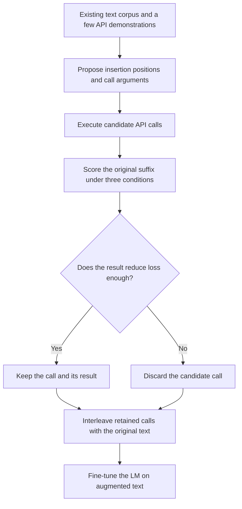
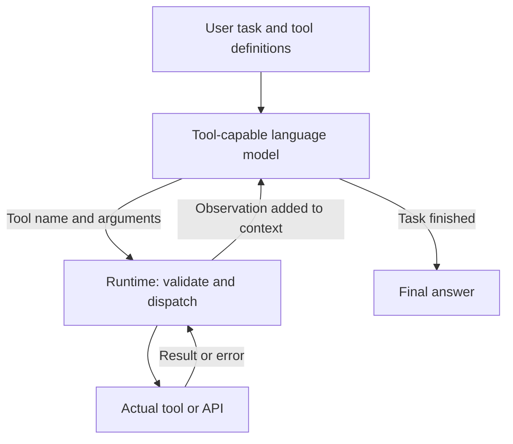

# Week 3 Questions and Answers

Lecture 4 discussions, the learner reflection, and the AI reference summary are recorded here. See the [Week 3 references](references.md) for official material and sources, and [progress](../../PROGRESS.md) for remaining applied evidence.

## What does Toolformer's Filter API Calls step do, and how are call positions chosen?

The learner asked about Lecture 4's Toolformer pipeline, especially where candidate API calls come from and how the filtering step works. PDF pages 24–28 present dataset augmentation, candidate sampling, execution, and usefulness filtering. Filtering here selects training examples using the reduction in future-token prediction loss. Runtime tool validation is a separate concern. [Slides and original method](references.md#toolformer-candidate-generation-and-filtering)

### The offline data construction and training pipeline



For each API, an annotation prompt provides instructions and a few demonstrations. At each original-text position i, the base model estimates `p_i = P_M(<API> | P(x), x_<i)`. Positions above a sampling threshold `tau_s` are retained, capped at the highest-scoring k positions. At each retained position, the model samples up to m call candidates, including arguments. This is proposal generation, not knowledge that a call is necessary. The API annotation prompt can contain the complete original text; this is offline annotation, not future information available to the deployed model.

The program executes each candidate to obtain its textual result. API execution success alone does not establish usefulness. The model's parameters are not being updated during candidate loss comparison; updates happen later during fine-tuning.

### Constructed calculator example

Use the original text: `Each batch contains 47 records and there are 19 batches, so the total is 893 records.` A useful proposed insertion is just before `893`. Two possible candidates are `Calculator(47*19)`, returning 893, and `Calculator(47+19)`, returning 66. Both operations are executable; only the first provides the intended computation.

To illustrate position selection, suppose the sampling threshold is 0.10 and the call-start probabilities after `Each batch contains`, after `the total is`, and after `893 records` are 0.02, 0.40, and 0.01 respectively. Only the second position passes this illustrative threshold. These probabilities are constructed, not model outputs or the paper's reported settings.

### The three-condition loss comparison

For the same original suffix, compute the base model's weighted next-token cross-entropy under three conditions:

| Condition | Information available in the scoring prefix | Purpose |
|---|---|---|
| No call | No API information | Baseline without a tool |
| Call only | API name and arguments, with an empty response | Control for information already present in the call text |
| Call and result | API name, arguments, and returned result | Measure the additional value of the tool response |

Let `L_plus` be the call-and-result loss and `L_minus = min(L_no_call, L_call_only)`. Keep the candidate only when `L_minus - L_plus >= tau_f`. Thus the result must improve on the stronger of both baselines. `tau_s` controls candidate position proposals, while `tau_f` controls usefulness filtering. These are distinct thresholds. [Filtering equations in Section 2](references.md#toolformer-candidate-generation-and-filtering)

For a one-target-token teaching simplification, treat the target number 893 as one token and use loss `-ln P(893)`. Actual tokenization may split the number, and the paper uses a weighted loss over multiple original suffix tokens.

| Scoring condition | Constructed probability of target 893 | Loss |
|---|---|---|
| No call | 0.10 | 2.302585 |
| Call only | 0.12 | 2.120264 |
| Call with product result 893 | 0.80 | 0.223144 |
| Alternative call with sum result 66 | 0.13 | 2.040221 |

For simplicity, both candidate call-only conditions are assigned the same constructed target probability of 0.12. Using an illustrative filtering threshold of 0.5, the product call improves the stronger baseline by 1.897120 and is retained. The alternative sum call improves it by only 0.080043 and is rejected in this constructed example. Local Python checked both arithmetic results and all negative-log calculations. No LM probabilities were measured.

During this filtering evaluation, the original paper prepends the candidate call information to the original text instead of inserting it at the proposed interior position. This avoids disrupting the baseline LM with an unfamiliar mid-text call pattern. After filtering, retained calls and results are inserted at their proposed positions in the augmented training corpus.

An augmented example can be `... the total is [Calculator(47*19) -> 893] 893 records.` The bracketed number is the observed tool result; the following number belongs to the original text continuation. Standard language-model fine-tuning then teaches the model the retained tool-use patterns. The API-marker notation in the paper is implemented with existing token sequences, not necessarily newly added vocabulary entries.

### Why this does not require a known answer at deployment

Offline filtering has the complete original text, so its suffix provides a self-supervised prediction target. At deployment, future text is unknown. The fine-tuned model generates a tool request from its current context; the runtime executes it, inserts the result, and resumes decoding. The original inference description pauses when the call's result delimiter is generated. It does not repeat the suffix-loss filtering process using a known correct answer for every live call.

| Phase | Available supervision | Main decision |
|---|---|---|
| Offline candidate filtering | Known original suffix and executed candidate responses | Which proposed call-result examples improve prediction enough? |
| Fine-tuning | Augmented text with retained calls | Update model parameters to learn tool-use patterns |
| Deployment | Current prompt, generated prefix, and actual tool observations | Generate a tool request or continue normal text |

The usefulness score is a proxy for helping this model predict this text. It is not a proof of general API correctness or permission to execute an action. The explanation covers the historical Toolformer method; it does not claim that every current tool-calling model is trained this way. No model training or external API-call experiment was run, and the learner's understanding remains unassessed.

## Is Toolformer still the usual approach, and what does current tool use look like?

As of November 24, distinguish the method for training a model from the interface used to connect an existing model to application tools. Toolformer's original contribution is a way to construct tool-augmented training text using suffix-loss filtering. Function calling is an inference interface; it is not a competing training objective. Based on current public platform documentation, a typical application uses an already tool-capable model, tool descriptions and schemas, and a runtime loop instead of reproducing the Toolformer training pipeline. This is a synthesis of public evidence, not a market-share measurement or a claim about undisclosed proprietary training recipes. [Current interfaces and training examples](references.md#toolformer-and-current-tool-use-practice)

### Application-side tool calling

The developer implements a tool and supplies its name, description, and argument schema. Given a request and those definitions, the model can emit a structured call. For an illustrative calculator, the request can produce `{"name":"calculate","arguments":{"expression":"47*19"}}`. The runtime validates the request, applies application permissions, executes the function, and returns its result. The model then continues with an answer or another tool request. The format here is provider-neutral teaching notation, not an executable request for a specific SDK. Client tools run in the application; hosted built-in tools can execute on the provider's infrastructure. [OpenAI and Claude tool-use documentation](references.md#toolformer-and-current-tool-use-practice)

Adding a tool can therefore mean providing a new definition and implementation, rather than retraining a model for each API. Success still depends on the model, tool descriptions, and task, so it should be evaluated. Schema constraints govern output structure; correct structure does not establish correct business arguments or execution authorization. MCP standardizes tool discovery and invocation between clients and servers and can supply tool definitions to this loop. It does not train the LM or replace the function-calling policy. The course's pinned MCP revision remains 2025-06-18. [Interface responsibilities](references.md#toolformer-and-current-tool-use-practice)

### Model-side training

Public examples show supervised learning from complete tool-use trajectories and, in some systems, reinforcement learning from environment feedback. A trajectory includes the task, tool definitions, model-generated calls, tool observations, subsequent actions, and final answer. These methods teach tool selection and argument construction as well as how to interpret results and continue a task.

| Aspect | Original Toolformer recipe | Examples from public later training reports |
|---|---|---|
| Training data construction | Insert sampled API calls into existing text | Collect real or simulated multi-turn interaction trajectories |
| Data selection | Reduction in original suffix prediction loss | Execution validation, task checks, filtering, and quality judgments, depending on the recipe |
| Parameter learning | Language-model fine-tuning on augmented text | Trajectory SFT; some models also use preference learning or environment-based RL |
| Application integration | Learned inline call notation and execution hook | Supported tool-call format, runtime tool definitions, and an execution loop |

Olmo 3 Instruct Section 5.2.1 documents SFT data with both real MCP interactions and simulated tool environments. Qwen3-Coder-Next's 2026 report documents execution-verified trajectories for SFT and multi-turn RL with task-completion rewards and tool-format penalties. These are concrete published examples, not a universal requirement that every tool model follow SFT with RL. [Open training reports](references.md#toolformer-and-current-tool-use-practice)

The enduring Toolformer idea is that useful tool use can be learned and that synthetic examples need selection. Current applications can consume tool-use ability already learned by a model provider, while developers focus on schemas, execution behavior, context, and evaluations. No SDK integration, training run, or model inference was performed for this comparison.

## Is ToolLLM more advanced than Toolformer?

ToolLLM addresses a broader setting: many real APIs, multi-tool instructions, and multi-step interactions. It is closer to the trajectory-based training approach just discussed, but this is a distinction in research scope, not evidence that every ToolLLM configuration universally outperforms Toolformer. ToolLLM was introduced in 2023 and presented at ICLR 2024, so it should not be treated as the latest default architecture in 2026. [Course and original work](references.md#toolllm-and-toolbench)

| Dimension | Toolformer | ToolLLM |
|---|---|---|
| Main problem | Learn useful call positions and arguments in text | Select and compose APIs for user instructions |
| Tool setting | Five demonstrated tool types | 16,464 curated REST APIs across 49 categories in the original work |
| Training data | Existing text augmented with calls selected by suffix-loss reduction | Instructions and executed multi-step solution trajectories generated using ChatGPT |
| Model learning | Fine-tune GPT-J on augmented text | Fine-tune LLaMA on the collected trajectories, producing ToolLLaMA |
| Scaling mechanism | The original demonstrated API repertoire | A neural retriever selects relevant API documentation for the controller |

ToolLLM names the overall framework. ToolBench is its dataset and evaluation resource, while ToolLLaMA names the trained language model. The paper's tool count and API count are different units: its curated collection has 3,451 tools containing 16,464 API endpoints. [Dataset and model definitions](references.md#toolllm-and-toolbench)

The original pipeline collects API descriptions and parameter specifications, generates single-tool and multi-tool instructions, and obtains successful solution paths through real API interactions. Its depth-first-search-based decision tree explores alternative paths to improve trajectory collection. Those paths support supervised training. At inference, a dense API retriever compares the instruction with API documentation and supplies relevant API candidates to ToolLLaMA. This connects to L03 retrieval, with tool descriptions rather than answer passages as the retrieved objects. [Data construction and retrieval](references.md#toolllm-and-toolbench)

For a constructed order tracking task, API retrieval can select `get_order` and `get_shipment` from a large catalog. The controller calls `get_order(order_id)`, reads the returned shipment ID, then calls `get_shipment(shipment_id)` and composes an answer. These names and interactions are illustrative, not a ToolBench execution trace. Retrieving the available API documentation and executing an API are separate stages.

The useful engineering ideas are task-level tool-use training, observation-dependent multi-step calls, and retrieval of relevant tool definitions. These ideas can inform systems using current tool-capable models without requiring deployment of the original ToolLLaMA checkpoint. No model benchmark, training, or API execution was performed for this explanation. [Implementation reference](references.md#toolllm-and-toolbench)

## What is Gorilla, and how does it differ from ToolLLM?

Gorilla is the course's example of training an LM to select an appropriate API and generate its call while reducing invented APIs or incorrect usage. The original work fine-tunes LLaMA-7B using APIBench, with 1,645 APIs from Hugging Face, Torch Hub, and TensorFlow Hub and GPT-4-generated instruction data. [Course and original method](references.md#gorilla-api-generation-and-retrieval)

With retrieval, inference takes a user request, retrieves API documentation, and gives both to Gorilla to generate a call. The original work also supports inference without retrieval. Retriever-aware fine-tuning includes API documentation in training prompts; this helps align training with document-conditioned inference. Retrieval quality still matters. Lecture slides emphasize learning to use or ignore retrieved context. The inspected arXiv v1 describes oracle-document training; it does not establish a specific mixture of correct and incorrect documents. [Training and inference](references.md#gorilla-api-generation-and-retrieval)

For a request to load a pretrained DenseNet-121 image classifier, the paper illustrates the historical call `torch.hub.load('pytorch/vision', 'densenet121', pretrained=True)`. Gorilla generates the call; a program executes it. Loading the model is distinct from performing image classification. This is a paper example, not a current executable compatibility check.

### How the original Gorilla is built and used

1. **Prepare API records.** Collect model cards and normalize functionality, function names, arguments, example calls, requirements, and other metadata. A documentation record is training/retrieval data, not an executed tool result.
2. **Generate instructions.** Given an API's documentation and a few demonstrations, GPT-4 generates user requests associated with that API. The original paper generates ten instruction/API pairs per API. GPT-4 helps build the offline dataset; deployment does not inherently require asking GPT-4 again.
3. **Fine-tune LLaMA.** Standard supervised instruction tuning teaches the model to generate reference responses containing API calls. In the retrieval-conditioned variant, the input also includes API documentation. In next-token training, predictions are compared with the target response and gradients update the model weights. The per-example target is response text; the final training artifact is a fine-tuned model. This training explanation connects the paper's SFT procedure to L02, without claiming a verified implementation-specific loss mask.
4. **Generate a call at inference.** A retriever can select documentation using the user's request; the original experiments include BM25 and GPT-Index. The request and selected documentation go to the trained model, which generates a call. A separate runtime would execute it. The paper focuses on call generation rather than a full multi-step execution loop. [Original training and inference](references.md#gorilla-api-generation-and-retrieval)

For a simplified teaching example, a request to load a pretrained PyTorch image classifier is paired with a reference document naming `torch.hub.load`, repository `pytorch/vision`, and model `densenet121`. The response contains the historical loading call above. This is a constructed training-record illustration, not a copied APIBench row or a measured prediction; many models could satisfy such a broad request.

Providing documentation during training teaches the model to use external specifications, while retrieval at inference supplies a particular specification without updating its weights. This combines learned API-call generation with retrieved context. It does not mean every API revision works automatically or every retrieval result is correct. The original paper also trains/tests versions without retrieval. No dataset, checkpoint, or dependency was downloaded and no model was run.

| Method | Useful study distinction |
|---|---|
| Toolformer | Learn useful call insertions using prediction-loss filtering |
| ToolLLM | Train on task trajectories that can compose multiple APIs |
| Gorilla | Train accurate API-call generation, including document-conditioned use |

These emphases overlap and are not a ranking. The lecture's AST evaluation parses generated code and matches selected call/argument structure against a reference; that is different from proving successful execution. The original Gorilla paper is also distinct from later Gorilla OpenFunctions releases. No model or API was run. Understanding remains unassessed.

## Lecture 4 slide summary: learning to use tools

The learner selected this comparison for later review. The table below transcribes the learner-provided screenshot of the official lecture's "Learning to Use Tools: Summary" slide, PDF page 45. It describes the lecture's historical research examples, not a new benchmark or a ranking. [Slide and interpretation references](references.md#learning-to-use-tools-comparison)

| Dimension | Toolformer | ToolkenGPT | ToolLLM | Gorilla |
|---|---|---|---|---|
| Tool call is | Text | One new token | ReAct-style trace | Text, API call code |
| What is trained | Model (GPT-J 6B) | Embeddings | Model (LLaMA 7B) | Model (LLaMA 7B) |
| Labels | Self-supervised | Ground-truth or synthetic calls | ChatGPT traces | GPT-4 self-instruct |
| Learns when | Loss filter | Embedding | Fine-tuning | Fine-tuning |
| Learns what | Fine-tuning | In-context | Fine-tuning | Fine-tuning |
| Scale | 5 tools | 234 tools | 16k APIs | 1.6k APIs |

Read the rows as call representation, trainable parameters, supervision source, decision mechanism, and demonstrated scale. The "Learns when" and "Learns what" rows are compact lecture shorthand:

- **Toolformer:** loss filtering selects useful training examples offline. Fine-tuning teaches the model the resulting call behavior; live calls do not require a known future answer or an online suffix-loss test.
- **ToolkenGPT:** each added token represents a tool choice, not a complete call including its arguments. The base LM is frozen while tool-token embeddings are trained. Predicting a tool token learns when and which tool to select; in-context demonstrations then guide argument completion. Interpret the slide's "in-context" cell with that distinction in mind. [Original framework](references.md#learning-to-use-tools-comparison)
- **ToolLLM:** the model trained in this column is ToolLLaMA; ToolLLM names the broader framework. A ReAct-style trace includes actions and observations, rather than only an isolated call.
- **Scale:** these are tool/API counts in the cited settings. They are neither accuracy scores nor universal capacity limits, and the studies use different tasks and tool definitions.

This is an intermediate lecture reference summary, not the learner's end-of-week reflection or evidence of completing L04.

## Do new tools always require retraining, and why does the lecture move to standard interfaces?

The learner correctly identified the lecture's transition toward describing tools at runtime and then quoted the slide's exact wording:

> Toolformer, ToolkenGPT, Gorilla: every new API means another training

The slide explicitly lists these three approaches, not ToolLLM. Its teaching contrast is between adapting learned parameters to tools and supplying tool contracts at runtime. The learner's interpretation of that transition is accurate. Read the research qualifications below as limits of the slide's broad wording, not as a rejection of the course's main point. Generalization and interface standardization remain related but distinct questions. [Primary evidence and interface references](references.md#new-tools-retraining-and-standard-interfaces)

| Approach | What adding a tool means in the relevant setting |
|---|---|
| Original Toolformer | Demonstrates a fixed five-tool repertoire; its original recipe is not a general runtime registration mechanism for arbitrary APIs. Extending training examples and fine-tuning is one adaptation route, not proof that every unseen API is theoretically impossible. |
| ToolkenGPT | Add a tool token and learn its embedding while keeping the base LM frozen. Training a small embedding differs from retraining the base model. |
| ToolLLM / ToolLLaMA | The paper evaluates unseen APIs and out-of-distribution APIBench tasks. API documentation can support generalization without a separate training run for each API; the experimental results are not guarantees for arbitrary tools. |
| Gorilla | Retrieval-conditioned generation supports tested changes in API documentation. This is evidence of document-based adaptation, not a universal claim about all new tools. |

The lecture's "Why Standard Interfaces?" contrast highlights the cost of adapting parameters for tool integration. "Another training" can include learning only new tool embeddings, as in ToolkenGPT; it does not necessarily mean retraining a whole LM from scratch. Gorilla's documentation-change experiments limit a literal reading of "every new API." ToolLLaMA's unseen-API results provide broader context but do not directly rebut the slide's three-method list, which excludes ToolLLM.

For an already tool-capable model, an application can supply a new tool's name, description, and input schema at inference. The model generates a request using that definition; application or provider infrastructure executes it. A constructed example is a newly registered `get_delivery_eta(shipment_id: string)` tool and the task of checking shipment `S456`. A possible request is `get_delivery_eta(shipment_id="S456")`. This illustrates the interface; it is not a measured prediction or a real API execution. Model weights remain unchanged when definitions are supplied in context.

Function calling exposes tool definitions and requests to the model-facing API. MCP standardizes discovery and invocation, including `tools/list` and `tools/call`. A tool can be backed by a REST service, exposed through MCP, and mapped into a model's function-calling interface. These layers can coexist. MCP does not train the model or grant understanding by itself, and runtime registration does not establish correctness on an unfamiliar task.

Distinguish learning general tool-use behavior from supplying a particular tool's contract. "No retraining per new tool" does not mean "the model never needed training." Learning how to interpret tool definitions can support inference-time use of new definitions. No training or runtime experiment was performed, and the clarified distinctions remain unassessed.

## How do MCP tool calls satisfy a schema, and what does MCP add to function calling?

MCP does not inherently make model-generated arguments more schema-compliant than function calling. Both can describe inputs with JSON Schema. Function calling connects a model's requested action to an application; MCP standardizes discovery and invocation between clients and tool servers. They can be used together. The course's MCP revision here is 2025-06-18. [Protocol and generation references](references.md#mcp-schema-validation-and-function-calling)

### Three different format checks

| Layer | Example check | Responsible component |
|---|---|---|
| Model output | Parse the provider's tool-call structure and arguments; confirm a known tool name | Model API, then host application |
| MCP request | JSON-RPC envelope, request ID, `tools/call`, and `params` structure | MCP client/server protocol implementation |
| Tool arguments | Validate `params.arguments` against the selected tool's `inputSchema` | Host validation can catch errors early; server must validate inputs before execution |

In a usual host-mediated integration, the model generates a provider-native tool request. The host maps its name and arguments to an MCP client call. Application code constructs the JSON-RPC envelope; the model need not generate it. Protocol-shape validation alone cannot validate a particular tool's argument contract.

For a constructed `get_order` tool, the input schema can be:

```json
{
  "type": "object",
  "properties": {
    "order_id": { "type": "string" }
  },
  "required": ["order_id"],
  "additionalProperties": false
}
```

`{"order_id":"O123"}` satisfies this schema. `{"order_id":123}`, `{}`, and `{"order_id":"O123","extra":true}` do not. A valid MCP request carrying the valid arguments is:

```json
{
  "jsonrpc": "2.0",
  "id": 1,
  "method": "tools/call",
  "params": {
    "name": "get_order",
    "arguments": { "order_id": "O123" }
  }
}
```

The host obtains definitions through `tools/list`, maps the tool to the model provider's format, and validates generated arguments before dispatch as an application design choice. The server validates inputs before business execution. The MCP specification requires server input validation; a declaration alone does not enforce it. Implementations or SDKs must perform the checks. Invalid arguments should yield an error rather than reach the business operation. Error feedback can support a later model correction, without guaranteeing that a retry succeeds.

### Constrained generation versus validation

Where a provider supports strict tool use, enabling it constrains generated inputs to the supported schema subset. Current Claude documentation describes grammar-constrained sampling; OpenAI also documents strict function calling. An MCP `inputSchema` does not automatically enable a provider's strict mode. The host must handle schema compatibility and configuration. Runtime validation remains a separate boundary. A schema-valid order ID may still refer to the wrong order, so task correctness and authorization require separate checks. [Strict generation and validation](references.md#mcp-schema-validation-and-function-calling)

### MCP's integration value

| Concern | Function-calling interface alone | MCP adds |
|---|---|---|
| Input contract | Provider-facing schema, such as `parameters` or `input_schema` | A server-advertised `inputSchema`, still JSON Schema |
| Discovery | Cross-service discovery is not specified by the tool-call format itself | Standard `tools/list` discovery |
| Invocation | Application chooses its dispatch mechanism | Standard `tools/call` and JSON-RPC messages |
| Results and errors | Application integrates backend responses with provider messages | Common tool-result and error structures; optional structured-output schema |
| Reuse | Cross-application backend integration is application-defined | A server can serve multiple compatible hosts; provider-specific mapping may still be needed |

### Same schema, different publication and reuse

The learner asked for a concrete comparison of a manually supplied function schema and one obtained from an MCP server. The argument constraints can be identical. The following illustrative JSON objects use the same `order_id` schema, first as an OpenAI Responses-style function definition and then as one tool record from an MCP `tools/list` response:

```json
{
  "type": "function",
  "name": "get_order",
  "description": "Look up an order by ID",
  "parameters": {
    "type": "object",
    "properties": { "order_id": { "type": "string" } },
    "required": ["order_id"],
    "additionalProperties": false
  },
  "strict": true
}
```

```json
{
  "name": "get_order",
  "description": "Look up an order by ID",
  "inputSchema": {
    "type": "object",
    "properties": { "order_id": { "type": "string" } },
    "required": ["order_id"],
    "additionalProperties": false
  }
}
```

The provider wrapper uses `parameters` here; Claude's corresponding client-tool field is `input_schema`. MCP uses `inputSchema`. A host can map compatible schemas into the provider wrapper and separately enable supported strict generation. This simple case does not establish that every MCP schema can be copied into every provider's supported subset unchanged. [Definition formats](references.md#mcp-schema-validation-and-function-calling)

For a constructed integration example, a web assistant and an IDE assistant both need order lookup and inventory queries. Without a shared integration layer, each application would need to handle the business APIs' endpoints, authentication, request/response mapping, and dispatch. Shared SDKs or an internal tool gateway can also centralize this work; function calling does not require hard-coded schemas or duplicated integrations.

With MCP, an Orders/Inventory server implements the business-specific integration once. Compatible hosts discover its tools through `tools/list`, map definitions to their model interfaces, and dispatch calls through `tools/call`. When the server adds `check_stock(sku)`, hosts can discover and expose that tool without a new per-tool dispatcher, provided their generic adapter supports its schema and behavior. Refreshing the tool list and applying permissions are still host responsibilities. Backend endpoint changes can be confined to the server when the exposed tool contract stays compatible; incompatible contract changes still require migration.

The saved integration code is the main benefit: model-facing definitions can come from a reusable service contract, while invocation and results follow one protocol. MCP is not uniquely capable of centralizing schemas, and it does not remove business-tool implementation or all provider adaptation.

### Does one MCP definition serve both OpenAI and Claude?

The learner proposed defining tools in the MCP server once so that OpenAI and Claude can share them. This correctly identifies tool-service reuse. The qualification is that each model still needs the relevant tool metadata in its own context or supported tool interface. The host, framework, or provider connector can discover and supply it, instead of the developer manually maintaining two business-tool definitions.

For the same server-defined `get_order(order_id: string)`, an OpenAI integration and a Claude integration can connect to that server and reuse its definition and implementation. Their provider-facing configuration and model messages are still different. Where direct function calling is used, a common canonical schema can also generate both provider wrappers; it is not inherently necessary to maintain two independent business definitions. MCP additionally standardizes discovery and execution across compatible hosts.

Current OpenAI remote-MCP integration and Claude's MCP connector document provider-managed discovery/invocation paths. These can remove the need to implement a separate client bridge in the application, within their supported configurations; they do not make the two provider APIs identical. These current implementation references supplement the course's pinned protocol revision. [Host and connector references](references.md#mcp-schema-validation-and-function-calling)

### When does MCP actually save work?

On November 25, the learner questioned whether MCP adds much when adding a local function already requires only a schema and registration. That is a valid comparison for a single application. The relevant question is which applications and teams must share the tool service, rather than whether one schema wrapper is more convenient.

**Scenario A: one application with a few local tools.** Consider a constructed assistant with `get_order(order_id)` and `check_stock(sku)`. Direct function calling needs implementations, model-facing definitions, and dispatch. An MCP version still needs implementations and definitions, plus an MCP server/client boundary and lifecycle. A server configuration alone does not implement a new business function. For this setting, direct calling may be simpler; MCP can add protocol, process/connection, and debugging work without a material reuse benefit. Switching the model provider alone does not necessarily justify that extra boundary.

**Scenario B: tools used through independently developed hosts.** GitHub publishes an official MCP server and host-specific connection instructions, including VS Code and Claude applications. A user can connect a compatible host, authenticate, and enable the desired tools without writing a new GitHub API implementation inside that host. The host already understands tool discovery and invocation, while the server implements the GitHub-specific operations. Its remote service is published at `https://api.githubcopilot.com/mcp/`. This is a documented example of protocol interoperability, not an integration executed in this workspace. [Official server and host documentation](references.md#when-mcp-reduces-integration-work)

A JSON Schema on its own cannot give an existing editor application a Python handler, backend endpoint mapping, or executable integration. Without MCP, another extension API, built-in connector, shared SDK, or gateway could supply that behavior, but it still needs an integration supported by the host. MCP's practical advantage is that independently developed hosts and tool servers already agree on a discovery/invocation contract. Configuration and authentication still vary by host.

For a constructed internal example, an operations team can publish an order-query MCP server for an internal assistant and an IDE host. Adding a compatible `get_shipment` tool requires server-side implementation and publication. A generic host that refreshes its tool list and permits the tool can reuse its existing dispatch path. No new business-API dispatcher is needed in each host. This does not mean every newly published tool is automatically enabled or every schema is supported by every model integration.

**Scenario C: an existing internal tool gateway.** If the learner already has a common tool registry, schema discovery, a generic invoke endpoint, centralized business integrations, and shared clients, they have comparable architecture for the discovery/invocation portion. MCP's incremental benefit is compatibility with outside hosts and servers, not a capability that their gateway could not implement. Adopting it may add little if those interoperability needs are absent.

| Situation | Mentor's engineering judgment |
|---|---|
| One controlled application and a few local tools | Direct function calling is often the smaller design |
| Changing OpenAI to Claude in the same application | Reuse canonical definitions and implementations; MCP is not inherently necessary |
| Connecting existing compatible applications to published tool servers | MCP can replace application-specific integration work with configuration and a common client path |
| Publishing a tool service for independently developed applications | A standard protocol can reduce custom client contracts and coordination |
| A mature internal gateway already meets the same needs | Evaluate ecosystem compatibility before adding another protocol |

These are scenario-based judgments, not measured productivity results. MCP does not guarantee more accurate model decisions or lower latency. Local stdio and remote-service deployments also have different operating costs. No server, extension, dependency, or model API was installed or run for this explanation.

### Interview answer: function calling versus MCP

The learner requested this mentor-written reference answer on November 25. It is interview preparation, not evidence that the learner has independently defended the design. [Supporting sources](references.md#when-mcp-reduces-integration-work)

**Suggested spoken answer, about 90 seconds:**

> Function calling and MCP address different boundaries. Function calling is the model-facing interface: I give the model tool definitions, and it can return a function name and structured arguments. The application or execution infrastructure runs the operation and returns its result.
>
> MCP is a protocol between an AI application and tool servers. It standardizes discovery, invocation, and result exchange, so compatible applications can reuse a tool service. The two can work together: a host presents MCP-discovered tools to a model through function calling, then routes the requested action to the MCP server.
>
> For one application with a few local functions owned by the same team, I would start with direct function calling. For example, order lookup can stay in the application's existing service layer, avoiding an additional protocol boundary.
>
> I would consider MCP when several independent applications need the same tools, or when integrating an existing MCP server. For example, an internal order service could expose tools for both a support assistant and an IDE host. The business integration stays in the server, while compatible hosts reuse standard discovery and invocation.
>
> My decision is based on interoperability and ownership boundaries versus connection, lifecycle, and compatibility costs. MCP does not automatically improve model accuracy or schema compliance. If an existing gateway already provides discovery and generic invocation, I would assess the ecosystem benefit before adding another protocol.

**Useful follow-up points:**

- **Can they coexist?** Yes. A host can use provider-native function calling for model requests and MCP for discovery and execution. Provider-managed MCP connectors can handle parts of that bridge.
- **Do two providers require two business definitions?** No. A canonical schema and implementation can serve multiple provider wrappers even without MCP. MCP adds a shared tool-service contract and compatible ecosystem.
- **Does MCP remove the need to tell the model about tools?** No. The host or provider integration still supplies the relevant descriptions and schemas; the developer need not manually duplicate them for every consumer.
- **What about correctness?** JSON Schema describes structure. Supported strict generation can constrain output, and the server validates inputs. Tool selection, business semantics, authorization, and task outcome remain separate concerns.
- **What about deployment?** MCP can use local processes or remote services. Do not assume every MCP call adds an internet round trip, or that either deployment has zero operating cost.

The scenario judgments are illustrative architectural choices, not a claim that MCP is always easier or a measured performance comparison. No additional reading, implementation exercise, or mock interview was assigned.

MCP's advantage here is a shared integration protocol, not a stronger guarantee that the LM selected the right action or emitted valid arguments. The two controls to separate are constraining generation and rejecting invalid inputs before execution. All examples are illustrative. No MCP server, model API, SDK, or validator was run or installed; detailed implementation remains unassessed.

## Are these all tool-calling models, and what is Lecture 4 teaching?

The learner correctly connects the research examples with training tool-use ability. Their explanation still groups methods, frameworks, and models together and treats native tool use in general models as a future possibility. The mentor clarified the following distinctions. [Lecture goals and supporting sources](references.md#lecture-4-concept-map)

| Name | What the name denotes here | Teaching contribution |
|---|---|---|
| Toolformer | A training method and the resulting tool-augmented model | Mine useful call examples with prediction-loss filtering, then fine-tune |
| ToolLLM | A framework covering data construction, training, retrieval, and evaluation | Collect task-solving trajectories and scale API selection |
| ToolLLaMA | The LLaMA-based model trained within ToolLLM | Generate actions and continue a task using tool observations |
| Gorilla | A research approach and trained model for API-call generation | Learn accurate calls, including conditioning on retrieved API documentation |

ToolLLM and ToolLLaMA are therefore not two independent successive model generations. These research examples also do not imply a required chain in which one model calls the next.

### Native tool use and runtime responsibilities

Current tool-capable general models can already emit tool requests directly. Supported tool definitions describe available functions and their inputs; the model can generate a call or an ordinary answer. A separate specialist model is an optional system component, not a requirement. A capability claim does not establish correctness on every API or task. [Current interfaces](references.md#toolformer-and-current-tool-use-practice)



This diagram illustrates a client-tool loop. Hosted tools can use provider-side execution infrastructure instead. Training updates model weights; inference supplies tasks, definitions, and observations to an already trained model. Tool selection and argument generation do not grant credentials or execute the business operation by themselves.

### The lecture's four organizing questions

1. **Why tools?** External programs supply computation and access to live, private, or otherwise unavailable information and actions.
2. **How is tool use learned?** The research examples illustrate training data, supervision, representations, API selection, and use of documentation. The preceding ToolkenGPT segment supplies another representation choice: learned tool tokens.
3. **How are tools connected?** REST describes service access, function calling supplies a model-facing call interface, and MCP supplies discovery and invocation across clients and servers. They can coexist in one application and are not model names.
4. **How is tool use evaluated?** BFCL, ToolBench, and tau-bench illustrate checks from individual calls to task interactions. Correct syntax alone does not demonstrate correct selection, arguments, ordering, recovery, permissions, task outcome, or consistency.

The interface and evaluation topics were initially introduced as a preview; subsequent Q&A records their discussion. These explanations alone do not establish lecture completion. As a mentor interpretation of the stated objectives, the practical goal is to explain where learned decisions end and application responsibilities begin, then measure whether the assembled system works. Reproducing each historical model is not necessary for this explanation. No training, runtime experiment, or new independent comprehension check was performed.

## How do the lecture's function/tool-calling benchmarks differ?

The lecture introduces BFCL, ToolBench, and tau-bench. Their coverage overlaps: BFCL is not limited to single calls, and the three resources are not mutually exclusive evaluation levels. The comparison below emphasizes the engineering questions each helps investigate. [Benchmark references](references.md#tool-calling-benchmarks)

| Benchmark | Main question | Tasks and evaluation |
|---|---|---|
| BFCL: Berkeley Function-Calling Leaderboard | Can the model select suitable functions and supply the correct arguments? | Single, multiple-choice, and parallel calls; relevance detection when no tool fits. AST checks compare calls with accepted references; executable cases check execution. V3 adds multi-turn/multi-step tasks with backend-state and response checks. |
| ToolBench, from ToolLLM | Can an agent solve instructions using a large real-API collection, including multi-tool paths? | Instructions and API interactions from the ToolLLM setting. ChatGPT-based ToolEval reports pass rate under a budget and win rate comparing two solution paths. Its pass rules also consider whether a request is solvable. |
| Original tau-bench | Can an agent complete a business task through user interaction and tools under domain policies? | A simulated user, domain rules, and database-backed tools, originally in retail and airline settings. Reward checks final database state and, where annotated, required information in user-facing responses. Repeated trials assess consistency. |

AST matching is more than verifying that JSON parses: it compares selected functions and arguments with references. Execution/state checks investigate behavior beyond output structure. In tau-bench, the paper explicitly notes that passing the reward check does not detect every possible policy violation. ToolEval's model judgments likewise differ from a deterministic business-state assertion.

### Pass at k versus pass hat k

- **pass@k:** the probability of at least one success in k independent trials of a task. It measures finding a solution with repeated attempts.
- **pass^k:** the probability that all k trials succeed. It measures repeated reliability.

For one illustrative task with independent, identical per-trial success probability p = 0.8 and k = 3, pass@3 = 1 - (1 - p)^3 = 99.2%, while pass^3 = p^3 = 51.2%. Local JavaScript arithmetic checked these values. They are a constructed probability example, not measured benchmark scores. Average these per-task quantities when describing a task set; do not simply exponentiate a pooled average success rate when tasks have different probabilities. [Original metric definition](references.md#tool-calling-benchmarks)

The paper estimates these metrics from n trials with c successes using binomial ratios: pass^k = C(c,k)/C(n,k), and pass@k = 1 - C(n-c,k)/C(n,k), then averages across tasks. The per-task estimates require n >= k, with C(a,k) = 0 when a < k.

### Connection to the preceding schema question

A schema-valid request can still select the wrong tool, use the wrong identifier, execute in the wrong order, or leave a task unfinished. A useful mentor interpretation of this section is to examine call correctness, task outcome, and repeated reliability separately. Benchmark version, tasks, model and agent configuration, budget, and evaluator must be held clear when comparing scores.

The learner said the lecture material feels sufficient and requested this summary for review. The subsequent [L04 reflection](#lecture-4-reflection-and-reference-summary) records the learner's takeaways and the AI reference summary supplied afterward. No benchmark, API, or model was run, and no additional reading or exercise was assigned.

## Lecture 4 reflection and reference summary

### Learner reflection

On November 24, the learner summarized their takeaways as follows (English translation):

> I mainly learned why to call tools, how to call them, and how to evaluate tool calling.

This identifies the lecture's main organizing questions. Earlier discussion also shows that the learner correctly recognized the transition toward runtime tool descriptions. Detailed application of schema validation, runtime boundaries, and benchmark design has not yet been independently demonstrated. The reflection was received before the following AI reference summary.

### AI reference summary

1. **Why tools are needed.** Model-generated text alone does not supply live/private data, dependable external computation, or business-system actions. Tools connect the model to programs that provide those capabilities.
2. **How a call becomes an action.** The model selects a tool and arguments. The runtime validates the request, checks authorization, executes the tool, and puts the observation back into context. The model can then choose another action or answer. A generated request and an executed operation are distinct events.
3. **Where tool-use capability comes from.** Toolformer, ToolkenGPT, ToolLLM/ToolLLaMA, and Gorilla illustrate different data, parameter-training, representation, and documentation strategies. They are not a required sequence of models that must call one another. Distinguish training general tool-use behavior from providing a particular API definition at inference. [Research comparison](#lecture-4-slide-summary-learning-to-use-tools)
4. **What the interfaces contribute.** Function calling supplies a model-facing tool interface. MCP standardizes client/server tool discovery and invocation. JSON Schema describes inputs in both settings. Strict generation, runtime schema validation, business correctness, and authorization remain separate concerns. [Schema and interface explanation](#how-do-mcp-tool-calls-satisfy-a-schema-and-what-does-mcp-add-to-function-calling)
5. **How to evaluate behavior.** BFCL examines function-calling capabilities, including multi-turn cases in later versions; ToolBench examines API-based task solving; tau-bench examines user-agent-tool business interactions. Separate valid structure, correct calls, completed tasks, and reliable repeated outcomes. pass@k means at least one success in k trials; pass^k means all k succeed. [Benchmark comparison](#how-do-the-lectures-functiontool-calling-benchmarks-differ)

### Expected application and next action

In later assignment work, use a concrete tool to identify its definition, model request, validation and authorization boundary, execution, returned observation, and success check. Distinguish a malformed request from a schema-valid request for the wrong entity or an unsuccessful business operation. This describes the expected application, not an assignment already implemented or an extra coding exercise for this session.

Continue with L05, Frameworks & Orchestration, when ready. Use the [official video](https://youtu.be/q0Q-Hy8TTps), with the verified entry in the [course resource index](../../resources/course-materials.md#l05). Viewing question: which control-flow, state, and error-handling responsibilities does a framework take over, and which remain with the application? No additional reading is assigned. M3 remains In Progress; this reflection does not establish completion of the module's applied criteria.
